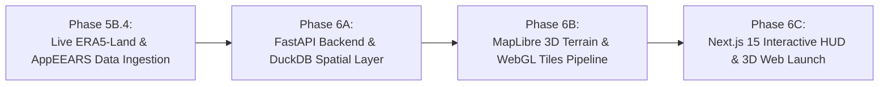

# FIREINTEL — Premium 3D Web Platform Technical Architecture Proposal

**Project:** FIREINTEL — Satellite-Based Forest Fire Intelligence System for Uttarakhand, India  
**Challenge:** NASA Space Apps Challenge 2026  
**Document:** Technical Architecture & Technology Stack Proposal for the FIREINTEL 3D Web Experience  
**Date:** 2026-11-13  
**Status:** **TECHNICAL PROPOSAL & SPECIFICATION (IMPLEMENTATION PENDING USER APPROVAL)**

---

## 1. Vision & Platform Experience

The future **FIREINTEL** web platform will be a cinematic, scientific, and tactical **3D Environmental Intelligence Platform**. Designed for researchers, disaster managers (Uttarakhand State Disaster Management Authority - USDMA), forest rangers, and NASA Space Apps evaluators, the platform transforms multi-gigabyte satellite observations and meteorological reanalyses into an intuitive, 60 FPS spatial experience.

```text
+-----------------------------------------------------------------------------------+
|  [FIREINTEL HUD]   Mode: 3D Tactical Terrain   Sensor: MODIS & VIIRS   Date: 2025 |
+-----------------------------------------------------------------------------------+
|                                                                                   |
|                                                                                   |
|                     * * * 3D HIMALAYAN TERRAIN * * *                              |
|                   (Copernicus DEM 30m Mesh Extrusion)                             |
|                                                                                   |
|                  ▲ Nanda Devi (7,804m) [Glacial White]                            |
|                 / \                                                               |
|                /   \     🔥 Active VIIRS Hotspot (FRP: 124 MW)                    |
|               /  ▲  \      [Glowing Amber Particle Sprite]                        |
|              /  / \  \                                                            |
|    ~~~~~~~~~/  /   \  \~~~~~~~~~~~~~~~~~~~~~~~~~~~~~~~~~~~~~~~~~~~~~~~~~~~~~      |
|    Foothills (Sal Belt)                                                           |
|                                                                                   |
+-----------------------------------------------------------------------------------+
|  [◀ 2025-01-01]  ═══════════════●══════════════════════════  [2025-12-31 ▶]       |
|  [Time Scrubber: 2025-05-18 IST]  [Playback: 1x, 2x, 5x]  [VPD: 3.4 kPa (Extreme)]|
+-----------------------------------------------------------------------------------+
```

---

## 2. Core Interactive 3D & 2D Experience Modes

### Mode 1: The Global Orbital View (Macro Experience)
- **Visuals:** An interactive 3D photorealistic Earth with atmospheric Rayleigh scattering, diurnal night-light transitions, and orbital ground tracks for Terra, Aqua, Suomi-NPP, and NOAA-20.
- **Functionality:** Displays global active fire clusters from NASA FIRMS. A spatial beacon anchors over northern India; clicking the anchor initiates a smooth, cinematic camera dive through the cloud layer directly into the Himalayan mountains of Uttarakhand.

### Mode 2: 3D Himalayan Tactical Terrain Explorer (Micro Experience)
- **Visuals:** High-fidelity 3D digital elevation mesh driven directly by our **Copernicus DEM GLO-30** dataset.
- **Topographic Styling:**
  - Dynamic procedural elevation gradient: subtropical lush green ($< 1,000\text{ m}$), temperate pine/oak ochre ($1,000\text{–}3,000\text{ m}$), alpine rocky grey ($3,000\text{–}4,500\text{ m}$), and permanent glacial snow ($> 4,500\text{ m}$).
  - Real-time hillshading and solar shadow casting based on the solar position at the selected hour of the day.
  - Valley wind streamlines rendered as animated vector particles flowing along mountain gorges (Bhagirathi, Alaknanda, Mandakini valleys).

### Mode 3: Satellite Fire Hotspot Visualization Layer
- **Visuals:** All **7,541 boundary-validated fire detections** rendered as GPU point sprites with emissive Bloom shaders.
- **Sensor Differentiation:**
  - **VIIRS (375m):** Sharp, high-density amber/crimson sparks with exact sub-kilometer accuracy.
  - **MODIS (1,000m):** Broad, glowing orange thermal blooms representing integrated radiative output.
- **FRP Dynamic Scaling:** Glow halo radius and particle intensity scale dynamically with Fire Radiative Power (MW). Clicking a hotspot reveals:
  - Exact overpass timestamp (UTC and IST)
  - Brightness temperatures ($T_{21}, T_{31}$ or $I_4, I_5$)
  - Detection confidence (MODIS % or VIIRS categorical)
  - Terrain context: Local elevation, slope, and aspect

### Mode 4: Environmental Intelligence & Tactical HUD
- **Master Grid Interaction:** Toggle the **2,174 cell Master Analysis Grid** ($0.05^\circ$).
- **Slide-Over Detail Panel:** Selecting any grid cell opens an animated dashboard displaying:
  - **Topographic Profile:** Mean elevation, slope steepness, circular aspect compass rose, and Riley TRI ruggedness score.
  - **Atmospheric State:** 2m Temperature gauge, Relative Humidity %, Vapor Pressure Deficit (VPD gauge indicating fine fuel drying hazard), and 10m Wind velocity vector arrow.
  - **Sub-Surface Hydrology:** 4-layer vertical soil moisture stack ($0\text{–}7\text{ cm}$, $7\text{–}28\text{ cm}$, $28\text{–}100\text{ cm}$, $100\text{–}289\text{ cm}$) showing water depletion levels.
  - **Antecedent Precipitation Index:** 1-day, 3-day, 7-day, and 14-day cumulative rainfall bars.

### Mode 5: Spatio-Temporal Playback & Predictive Fire-Risk Map
- **Temporal Time Scrubber:** Smooth scrubbing across all 365 days of 2025. Users can press Play to watch the annual fire wave ignite during the March heatwaves, peak across Almora and Chamoli in May–June, and instantly extinguish with the arrival of the Indian Summer Monsoon in July.
- **Prognostic Fire-Risk Mode:** Colors the Master Grid cells by synthesized wildfire susceptibility (Low, Moderate, High, Extreme) with an interactive **SHAP Explainability Flyout** (e.g., *"Risk score 88/100 driven 42% by VPD > 3.2 kPa, 31% by 32° south-facing slope, and 27% by depleted Layer 1 litter moisture"*).

---

## 3. Technology Stack Evaluation & Recommendations

```mermaid
flowchart TD
    subgraph Client Application (Next.js 15 + TypeScript)
        UI["UI Layer: Tailwind CSS v4 + shadcn/ui\nGlassmorphic HUD Overlay"]
        STATE["State Management: Zustand\n(Active Filters, Date Scrubber, Camera Mode)"]
        
        subgraph 3D & Geospatial Rendering Engine
            THREE["Three.js / React Three Fiber\n(Hero Globe & Atmospheric Shader)"]
            MAP["MapLibre GL JS v4 / deck.gl\n(3D Himalayan Terrain Mesh & MVT/PMTiles)"]
        end
    end

    subgraph High-Performance API & Data Engine
        FAST["FastAPI Backend (Python 3.14)\nAsynchronous REST & WebSocket Endpoints"]
        DUCK["DuckDB In-Memory Engine\nDirect Parquet & Spatial SQL Queries (< 5ms)"]
        TILES["Vector & Raster Tile Pipeline\nRGB Terrain DEM Tiles + GeoParquet/PMTiles"]
    end

    subgraph Cloud Storage & Edge Distribution
        S3["AWS S3 / Cloudflare R2\nStatic COGs, Parquet Files, VRTs"]
        EDGE["Cloudflare Edge CDN\nGlobal Sub-100ms Asset Delivery"]
    end

    UI --> STATE
    STATE --> THREE
    STATE --> MAP
    MAP <-->|"GeoJSON / Vector Tiles"| FAST
    FAST <--> DUCK
    DUCK <--> S3
    S3 --> EDGE
```

### 3.1 Frontend Framework: Next.js 15 (React 19) + TypeScript
- **Rationale:** Next.js provides App Router with Server Components for instant initial page loads and SEO-optimized educational landing pages, combined with performant client-side WebGL canvas mounts. TypeScript enforces strict types for all 25 environmental and fire attributes.

### 3.2 3D Graphics & Rendering Engine: Hybrid Three.js + MapLibre GL v4
We evaluated three leading WebGL/WebGPU architectures:

| Engine | Strengths | Limitations | Recommended Role in FIREINTEL |
| :--- | :--- | :--- | :--- |
| **Three.js / React Three Fiber** | Total shader freedom, cinematic lighting, post-processing (Bloom, DOF), custom camera animations. | Difficult geographic tiling; floating-point jitter at regional scale without custom coordinate origins. | **Primary Engine for Hero 3D Globe & Atmospheric Intro.** |
| **MapLibre GL JS v4 (WebGL2)** | Native 3D terrain elevation raster protocol, Web Mercator projection, zero jitter, 60 FPS MVT vector tile streaming, built-in pitch/bearing. | Limited custom GLSL particle shaders compared to Three.js. | **Primary Engine for 3D Uttarakhand Tactical Terrain & Grid.** |
| **deck.gl v9 (vis.gl)** | High-performance GPU data visualization (handles millions of points), native integration with MapLibre GL. | Requires base map integration. | **Integrated into MapLibre GL for FRP point sprites & vector arrows.** |

**Hybrid Recommendation:**  
- **Landing / Hero:** React Three Fiber renders the cinematic 3D Earth.
- **Tactical Dashboard:** Seamless transition into MapLibre GL JS v4 utilizing Copernicus DEM-derived **Terrain RGB tiles** for true 3D topography, overlaid with deck.gl layers for fire hotspots and environmental grids.

### 3.3 Backend API Engine: FastAPI (Python 3.14) + DuckDB Spatial
- **FastAPI:** High-speed asynchronous Python framework. Leverages our existing Python transformation and validation codebase without language rewrites.
- **DuckDB with Spatial Extension:** Acts as an ultra-fast in-memory analytical query engine. DuckDB executes spatial joins and temporal filters directly over `master_grid_005deg.parquet` and `dem_terrain_features_005deg.parquet` in **less than 5 milliseconds**, eliminating the need for a heavy PostGIS database server.

### 3.4 Data Conversion Pipeline for Web Streaming
To stream our current offline data to the browser at 60 FPS:
1. **Copernicus DEM VRT $\to$ Terrain-RGB Tiles:** Convert [copernicus_dem_uttarakhand.vrt](file:///Users/macbook/Documents/Nasa_Space_Hackathon/fireIntel/data/environmental/processed/copernicus_dem_uttarakhand.vrt) into Mapbox-compatible RGB PNG tiles where elevation is encoded as:
   $$\text{Elevation (m)} = -10,000 + \left(R \times 256 \times 256 + G \times 256 + B\right) \times 0.1$$
   MapLibre GL uses these tiles to dynamically extrude real Himalayan topography.
2. **Master Grid $\to$ PMTiles / Vector Tiles:** Convert the 2,174 cells into a single PMTiles archive (~1.2 MB) enabling zero-latency client-side rendering.
3. **Fire Hotspots $\to$ Compact FlatGeobuf / GeoJSON:** Stream 7,541 fire detections with temporal attributes in a binary format under 450 KB.

---

## 4. Responsive Mobile & Performance Optimization

To ensure seamless execution on devices ranging from high-end desktop workstations to mobile tablets:
1. **WebGL Level-of-Detail (LOD):**
   - *Desktop:* Full 30m terrain mesh resolution, dynamic SSAO (Screen Space Ambient Occlusion), and bloom halos.
   - *Mobile:* Dynamic downsampling to 90m terrain mesh, disabling post-processing bloom, and clamping point sprite counts to maintain 60 FPS.
2. **Glassmorphic HUD Design:**
   - Dark mode aesthetic inspired by NASA mission control and modern aerospace interfaces (`#0A0E17` background with `#00E5FF` cyan and `#FF5722` amber accents).
   - Semi-transparent backdrop blur (`backdrop-blur-md`) allowing continuous visibility of the 3D terrain beneath data cards.

---

## 5. Architectural Implementation Phasing



Implementation will proceed strictly in Phase 6 after Phase 5 environmental data ingestion is fully completed and approved.

