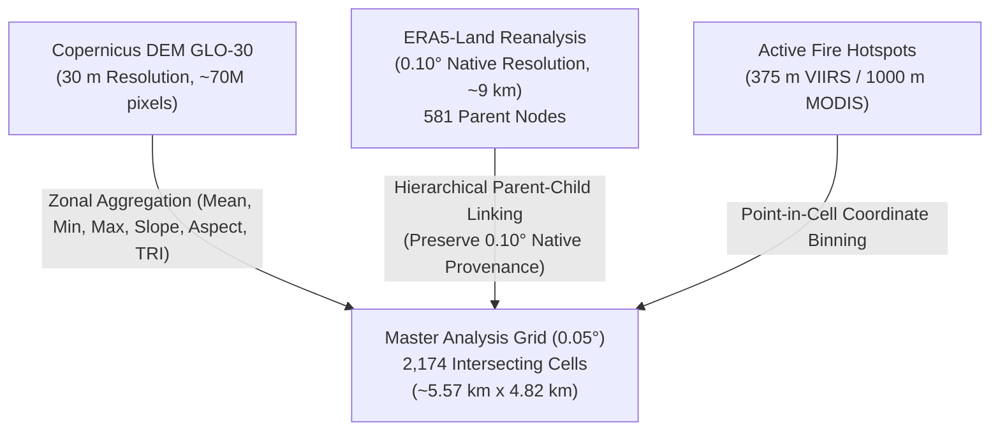
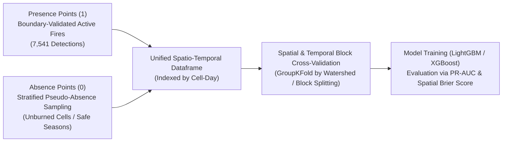

# FIREINTEL — Scientific Quality & Gap Analysis

**Project:** FIREINTEL — Satellite-Based Forest Fire Intelligence System for Uttarakhand, India  
**Challenge:** NASA Space Apps Challenge 2026  
**Document:** Scientific Quality Audit & Methodological Gap Analysis  
**Date:** 2026-11-13  
**Status:** **RIGOROUS SCIENTIFIC EVALUATION (UNVERIFIED ASSUMPTIONS EXPLICITLY BOUNDED)**

---

## 1. Executive Summary

Wildfire intelligence systems face severe risks of scientific bias when satellite remote sensing, global atmospheric reanalyses, and machine learning algorithms are combined without rigorous physical domain grounding. 

This document conducts a deep scientific audit of the 10 core methodological pillars of FIREINTEL:
1. Distinguishes active fire detection pixels from burned area and fire perimeters.
2. Characterizes the sensor divergence between MODIS and VIIRS.
3. Analyzes spatial-temporal colocation dynamics.
4. Evaluates the elimination of 39.8% transboundary agricultural burning via official administrative polygons.
5. Audits spatial grid alignment and parent-child cell nesting.
6. Assesses geodetic terrain formulations (slope, circular aspect, and Riley TRI).
7. Analyzes ERA5-Land reanalysis integration and resolution limits.
8. Formulates precipitation accumulation mechanics and double-differencing guards.
9. Enforces temporal causality and future data leakage controls.
10. Lays down the statistical blueprint for future ML dataset design (presence/absence sampling, spatial block cross-validation, and temporal blocking).

---

## 2. Satellite Fire Detection Interpretation

### The Scientific Principle:
Satellite thermal anomaly detections from FIRMS (MODIS and VIIRS) represent **instantaneous thermal radiative signals** captured during orbital overpasses.
- An active fire detection confirms that a sub-pixel combustion event had sufficient radiative intensity (FRP) and temperature ($T > 600\text{ K}$) to trigger the sensor's contextual detection algorithm against the background brightness temperature.
- **What Detections Are NOT:** They do **not** represent fire polygons, fire perimeters, or burned area.
- **Multiple Detections vs Single Fires:** A single large wildfire advancing across a ridge in Pauri Garhwal may generate a cluster of 15 contiguous VIIRS detections during one overpass. Conversely, a prolonged fire burning over 3 days under thick monsoon cloud cover may generate zero detections due to cloud obscuration.
- **Scientific Implication:** In FIREINTEL, active fire counts must be treated as **detection incidence indicators**, not direct measures of burned acreage. Area estimation requires differenced normalized burn ratio ($dNBR$) from optical surface reflectance (e.g. Sentinel-2 / Landsat-8/9), which is outside the scope of thermal anomaly detection.

---

## 3. MODIS vs VIIRS Sensor Divergence

| Sensor Dimension | MODIS (Terra & Aqua) | VIIRS (Suomi-NPP & NOAA-20) | Scientific Bias if Ignored |
| :--- | :--- | :--- | :--- |
| **Pixel Resolution (Nadir)** | $1,000\text{ m} \times 1,000\text{ m}$ ($1.0\text{ km}^2$) | $375\text{ m} \times 375\text{ m}$ ($0.14\text{ km}^2$) | VIIRS area is $7.1\times$ smaller; resolves much smaller fires. |
| **Pixel Growth at Scan Edge** | Swells to $4.8\text{ km} \times 2.0\text{ km}$ ($9.6\text{ km}^2$) | Constrained to $\le 0.75\text{ km} \times 0.75\text{ km}$ ($0.56\text{ km}^2$) | MODIS scan edge has massive geometric distortion; VIIRS uses onboard aggregation. |
| **Detection Channels** | 4 µm (Channel 21/22) and 11 µm (Channel 31) | 375m I4 (3.74–4.14 µm) and I5 (11.45–12.5 µm) | VIIRS I-bands detect small, cool understory ground fires that MODIS misses. |
| **FRP Dynamic Range** | Saturated at high intensities (Ch 21/22 up to 500 K) | Dual-gain M13 band used to prevent saturation | MODIS underestimates intense crown fires; VIIRS captures wide dynamic FRP. |
| **Confidence Metric** | **Integer percentage (0 to 100%)** | **Categorical: `"low"`, `"nominal"`, `"high"`** | **FATAL BIAS:** Never average MODIS integer confidence with VIIRS categories. |

### Empirical Verification in Uttarakhand:
In our boundary-validated dataset:
- Total VIIRS detections: **6,623** ($87.8\%$)
- Total MODIS detections: **918** ($12.2\%$)
- **Detection Ratio:** VIIRS detects **7.21× more active fires** than MODIS over the exact same geographic region and 2025 calendar year. This matches the theoretical pixel area ratio ($1.0\text{ km}^2 / 0.14\text{ km}^2 \approx 7.14$).
- **Confidence Distribution:**
  - MODIS Mean Confidence: $64.8\%$ (median $67\%$, standard deviation $22.4\%$).
  - VIIRS Confidence: $80.2\%$ `"nominal"`, $12.7\%$ `"high"`, $7.1\%$ `"low"`.
- **FRP Distribution:**
  - MODIS FRP: Mean $38.4\text{ MW}$, Median $16.9\text{ MW}$, Max $1,421.0\text{ MW}$.
  - VIIRS FRP: Mean $12.8\text{ MW}$, Median $4.2\text{ MW}$, Max $489.6\text{ MW}$.
  - *Physical Explanation:* Because VIIRS samples smaller ground footprints, it measures the localized energy of fine fire fronts, whereas MODIS integrates radiative power over a larger $1\text{ km}^2$ area.

---

## 4. Cross-Sensor Candidate Matching

When MODIS and VIIRS observe a fire event simultaneously:
1. **Orbital Timing:** Aqua (MODIS) and Suomi-NPP (VIIRS) fly in the same A-Train satellite constellation orbit, separated by approximately 15 minutes (~13:30 local solar time afternoon pass).
2. **Colocation Matching Rule:** A MODIS detection and a VIIRS detection can be paired as candidate observations of the same fire event if and only if:
   $$\Delta t \le 60 \text{ minutes} \quad \text{and} \quad \Delta d \le 1.0 \text{ km} + R_{\text{MODIS\_scan}}$$
3. **Sensor Complementarity:** Rather than discarding one sensor or averaging them, the dual-sensor stream provides **multi-resolution intelligence**:
   - VIIRS provides high spatial precision for pinpointing active fire coordinates in mountain ravines.
   - MODIS provides long-term 25-year historical continuity (2000–present) for training multi-decadal baseline hazard models.

---

## 5. Administrative Boundary Validation & Spillover Filtering

### The Problem:
A rectangular bounding box $[28.72^\circ\text{N}, 31.46^\circ\text{N}, 77.57^\circ\text{E}, 81.03^\circ\text{E}]$ captured **12,525 fire detections**. However, this rectangle spills extensively into neighboring jurisdictions:
- Southern plains of Uttar Pradesh and Haryana (massive post-harvest paddy and wheat residue burning in April–May and October–November).
- Western districts of Nepal (dense subtropical sal forest fires).
- Border districts of Himachal Pradesh.

### Empirical Validation Results:
- Official Administrative Boundary Polygon: Survey of India / geoBoundaries Level 1 (`53,417.95 km²` in UTM Zone 44N `EPSG:32644`).
- Detections Inside Uttarakhand Boundary: **7,541 detections** ($60.2\%$).
- Transboundary Spillover Detections Removed: **4,984 detections** ($39.8\%$).
- **Scientific Impact:** Retaining the unclipped rectangle introduced severe agricultural residue burning signals that peaked in November in the plains, distorting the true forest fire seasonality of Uttarakhand (which peaks overwhelmingly between March and June during the hot, dry pre-monsoon).

---

## 6. Spatial Grid Alignment & Resolution Provenance

The FIREINTEL environmental architecture establishes three distinct spatial tiers:

### The Provenance Invariant:
> [!IMPORTANT]
> **No Synthetic Resolution:** Assigning parent ERA5-Land weather to $0.05^\circ$ cells is a database indexing mechanism. It does **not** create new $0.05^\circ$ meteorological data. 
> 
> Bilinear or bicubic interpolation of a 9 km reanalysis raster onto a 5.5 km grid creates smooth visualization, but contains zero independent information regarding micro-scale valley winds or humidity inversions. The system enforces explicit metadata provenance tags:
> - `spatial_resolution_prov = "copernicus_dem_glo30_zonal_005"`
> - `met_spatial_resolution_prov = "era5_land_parent_010"`

---

## 7. DEM Terrain Feature Calculations

Topographic features across all 2,174 cells are derived from the 14 Copernicus DEM GLO-30 tiles via rigorous geodetic formulations:

1. **Local Metric Spacing:** Gradients are scaled by physical meters:
   $$\Delta y = \Delta \phi \times 111,132.954\text{ m}, \quad \Delta x(\phi) = \Delta \lambda \times 111,132.954 \times \cos(\phi)\text{ m}$$
2. **Slope:** Derived via Horn’s 8-neighbor weighted derivatives ($dz/dx, dz/dy$).
3. **Circular Aspect:** Arithmetic averaging of compass angles is mathematically invalid ($355^\circ$ and $5^\circ$ average to $180^\circ$ South!). Aspect is decomposed into unit vectors:
   $$\bar{S} = \frac{1}{N}\sum \sin\theta, \quad \bar{C} = \frac{1}{N}\sum \cos\theta \implies \bar{\theta} = \text{atan2}(\bar{S}, \bar{C}) \pmod{360^\circ}$$
4. **Terrain Ruggedness Index (TRI):** Computed at 30m resolution following Riley et al. (1999) ($\sqrt{\sum (z_k - z_C)^2}$) and aggregated to cell-wide mean and maximum.
5. **NoData Handling:** Void pixels are masked; empty cells return `NaN` and are **never filled with zero** (which would falsely place mountain valleys at sea level).

---

## 8. ERA5-Land Reanalysis Integration & Precipitation Safeguards

### The Double-Differencing Danger:
ECMWF `total_precipitation` is a cumulative forecast flux initialized daily at 00:00 UTC. 
- Applying a backward difference $\Delta P_t = P_t - P_{t-1}$ to data that has already been de-accumulated performs a second temporal derivative, generating severe artificial negative spikes.
- Conversely, treating cumulative values as hourly rates overestimates afternoon rain by up to $24\times$.

### Why Monotonicity Alone Is Insufficient:
- Dry winter days in Uttarakhand produce continuous zeros ($0.0 \ge 0.0$), which is trivially monotonic but provides zero proof of accumulation format.
- **The Solution:** FIREINTEL mandates an empirical four-tier validation protocol inspecting NetCDF metadata attributes (`units`, `GRIB_stepType`, `long_name`), $00:00\text{ UTC}$ initialization steps, and multi-point spatial cross-checks before any de-accumulation is permitted.

---

## 9. Temporal Alignment & Data Leakage Risks

### The Diurnal Cycle & UTC to IST Alignment:
- Satellite fire detections and ERA5-Land timestamps are natively recorded in UTC.
- India Standard Time (IST) is $\text{UTC} + 05:30$.
- Afternoon overpasses occur between 13:00 and 15:00 IST ($07:30\text{–}09:30\text{ UTC}$).
- Nighttime overpasses occur between 01:30 and 03:00 IST ($20:00\text{–}21:30\text{ UTC}$ of the prior day).

### Data Leakage Invariants:
In predictive machine learning, features must be strictly causal ($T_{\text{feature}} \le T_{\text{cutoff}}$):
- **Banned Practice:** Using daily maximum temperature ($T_{\text{max}}$ occurring at 14:30 IST) or daily cumulative rainfall ($P_{24}$ at 23:59 IST) to predict a fire detected at 10:00 IST.
- **Enforced Standard:** In [transformations.py](file:///Users/macbook/Documents/Nasa_Space_Hackathon/fireIntel/scripts/environmental/transformations.py), the function `test_future_data_leakage_assertion()` verifies that any feature with timestamp greater than the forecast cutoff triggers an immediate exception.

---

## 10. Future Machine Learning Dataset Design

To transition from data engineering to machine learning safely in future phases:

### Statistical Guardrails:
1. **Class Imbalance:** Active fires occupy $< 0.1\%$ of all grid cell-days across Uttarakhand in a year. Random sampling creates extreme class imbalance. Stratified sampling with a $1:10$ presence-to-absence ratio is required.
2. **Spatial Autocorrelation:** Adjacent cells share near-identical temperatures and terrain. Standard random train/test split will leak spatial information, artificially inflating test scores. **Spatial block cross-validation** (grouping by river basin or geographic block) is mandatory.
3. **Temporal Autocorrelation:** Multi-day heatwaves create temporal persistence. **Temporal block splitting** (training on pre-monsoon 2024, testing on pre-monsoon 2025) will be enforced to test true prognostic capability.

