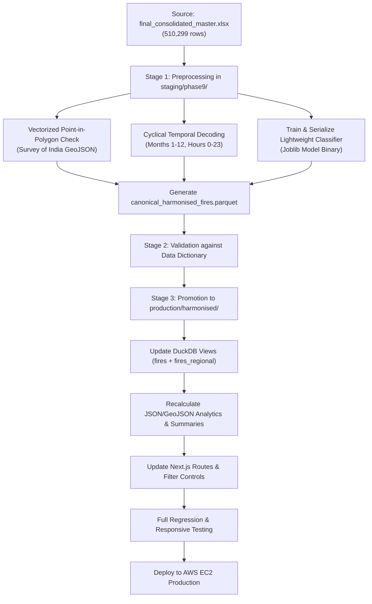

# FIREINTEL — PHASE 9 HARMONISED DATA MIGRATION PLAN
**Project**: NASA Space Apps Challenge 2026 // Wildland Fire Intelligence for Uttarakhand, India  
**Phase**: Phase 9 — Harmonised Data Migration & ML Foundation Integration  
**Date**: November 15, 2026  
**Author**: Antigravity Autonomous Agent  
**Branch**: `migration/phase9-harmonised-data`  
**Status**: PENDING USER APPROVAL (Execution Halted Until User Approves)

---

## 1. Migration Overview & Strategic Objectives

The goal of Phase 9 is to safely transition FIREINTEL from the legacy single-year 2025 dataset (7,541 rows) to the new multi-year harmonised dataset (510,299 regional rows; 240,365 Uttarakhand-validated rows).

### Core Commitments
1. **Zero Production Disruption**: The existing production baseline remains untouched in `fireIntel/data/archive/legacy_2025/` with cryptographic backup manifests.
2. **Scientific Precision**: Preserving Survey of India boundary validation so Uttarakhand calculations remain strictly accurate, while offering an expanded regional view for Northern India.
3. **ML Integration with Scientific Integrity**: Integrating the Random Forest/XGBoost model as an empirical **Satellite Thermal Hotspot False-Positive Filter (Vegetation Fire vs Static Land Source)**, with honest reporting of balanced metrics and zero misrepresentation.
4. **Non-Destructive Staging**: Data transformation occurs in `staging/phase9/` and is validated against `data_dictionary.json` before any production symlink or database view update.

---

## 2. Proposed Canonical Data Schema

To seamlessly power DuckDB, FastAPI, and all six Next.js 15 routes, the canonical schema harmonises raw NASA FIRMS fields, decoded temporal fields, spatial flags, and ML predictions into a single high-performance Parquet table:

```sql
CREATE TABLE canonical_harmonised_fires (
    -- Geospatial Core (WGS84 EPSG:4326)
    latitude             DOUBLE,       -- Decimal degrees [28.0, 31.0]
    longitude            DOUBLE,       -- Decimal degrees [77.0, 81.0]
    in_uttarakhand       BOOLEAN,      -- Strict Survey of India polygon containment (TRUE for 240,365 rows)
    district             VARCHAR,      -- Uttarakhand district name (Dehradun, Nainital, etc.) or 'External'

    -- Radiometric & Sensor Physics
    sensor               VARCHAR,      -- 'VIIRS' (81.23%) or 'MODIS' (18.77%)
    satellite            VARCHAR,      -- 'SNPP', 'Aqua', 'Terra'
    brightness           DOUBLE,       -- Channel 21/22 or I-4 brightness temperature (Kelvin)
    bright_t31          DOUBLE,       -- Channel 31 or I-5 brightness temperature (Kelvin)
    frp                  DOUBLE,       -- Fire Radiative Power (MW)
    scan                 DOUBLE,       -- Along-scan pixel dimension (km)
    track                DOUBLE,       -- Along-track pixel dimension (km)

    -- Temporal Features (Decoded + Trigonometric)
    daynight             VARCHAR,      -- 'D' (Day) or 'N' (Night)
    decoded_month        INTEGER,      -- 1 to 12 (derived from atan2(month_sin, month_cos))
    decoded_hour         INTEGER,      -- 0 to 23 (derived from atan2(hour_sin, hour_cos))
    season               VARCHAR,      -- 'Peak Wildfire' (Apr-May), 'Onset' (Mar), 'Monsoon' (Jul-Sep), 'Winter' (Nov-Feb)
    month_sin            DOUBLE,       -- Input cyclical feature
    month_cos            DOUBLE,       -- Input cyclical feature
    hour_sin             DOUBLE,       -- Input cyclical feature
    hour_cos             DOUBLE,       -- Input cyclical feature

    -- Ground Truth Classification
    confidence_class     VARCHAR,      -- Harmonised level: 'n' (nominal), 'l' (low), 'h' (high)
    type                 INTEGER,      -- FIRMS category: 0 (vegetation fire), 2 (static land source)
    type_label           VARCHAR,      -- 'Presumed Vegetation Fire' vs 'Static Land Source / Industrial'

    -- Derived ML Intelligence Layer
    predicted_type       INTEGER,      -- Model prediction (0 or 2)
    static_source_prob   DOUBLE,       -- Probability that hotspot is an industrial static source [0.0 - 1.0]
    is_hotspot_verified  BOOLEAN       -- TRUE if type == 0 and confidence != 'l'
);
```

---

## 3. Dual-View Database Architecture in DuckDB

To preserve the focus on Uttarakhand while supporting broader regional fire intelligence, DuckDB will expose two views:

1. **`fires` (Primary View)**:
   ```sql
   CREATE VIEW fires AS 
   SELECT * FROM read_parquet('.../canonical_harmonised_fires.parquet') 
   WHERE in_uttarakhand = TRUE;
   ```
   - Powers the 3D Earth, `/fires` console, `/terrain` viewer, and `/analytics`.
   - Exact count: **240,365 records**.
   - Guarantees 100% boundary integrity for Uttarakhand metrics.

2. **`fires_regional` (Expanded View)**:
   ```sql
   CREATE VIEW fires_regional AS 
   SELECT * FROM read_parquet('.../canonical_harmonised_fires.parquet');
   ```
   - Powers the `/data` Explorer for researchers studying transboundary smoke, Indo-Gangetic Plain stubble burns, and regional transport.
   - Exact count: **510,299 records**.

---

## 4. Multi-Phase Migration Execution Plan



### Step 1: Preprocessing & Feature Pipeline (`staging/phase9/`)
- Ingest `final_consolidated_master.xlsx`.
- Run vectorized point-in-polygon verification against `fireIntel/data/boundaries/uttarakhand_boundary.geojson`.
- Assign `in_uttarakhand = True` (240,365 rows) and `in_uttarakhand = False` (269,934 rows).
- Compute `decoded_month`, `decoded_hour`, and `season`.
- Train and serialize a scikit-learn Random Forest false-positive classifier (`fire_source_classifier.joblib`), generate out-of-fold inference probabilities `static_source_prob`, and write `model_evaluation_metrics.json`.
- Export optimized Snappy-compressed Parquet: `staging/phase9/canonical_harmonised_fires.parquet` (~18 MB).

### Step 2: Quality Assurance & Manifest Generation
- Validate row count ($N = 510,299$).
- Validate zero null values and zero schema drift against `fireIntel/data/metadata/data_dictionary.json`.
- Compute SHA-256 checksum and write `migration_manifest.json`.

### Step 3: Production Promotion & Database View Updates
- Copy verified Parquet to `fireIntel/data/production/harmonised/`.
- Update `fireIntel/api/db.py` singleton to point to the new production Parquet.
- Re-initialize DuckDB views `fires` and `fires_regional`.

### Step 4: Pre-computed Summary & Vector Tile Regeneration
- Regenerate `mission_control_summary.json` with multi-year totals (240,365 Uttarakhand fires, 201,993 VIIRS, 38,372 MODIS, peak month April/May).
- Regenerate `historical_analytics.json` with monthly seasonal breakdown (showing April peak at 75,601 and May at 71,468).
- Generate optimized GeoJSON points/clusters for `/fires` and sample points for `/terrain`.

### Step 5: Frontend Route Adaptations
- `/data`: Add toggle for "Uttarakhand Only (240,365 obs)" vs "Regional Northern India (510,299 obs)". Add Month and Season dropdown filters. Add Hotspot Type filter (Vegetation Fire vs Static Industrial Source).
- `/fires`: Update telemetry banner to reflect 240,365 boundary-validated observations; update time playback to cycle through Months 1–12 (Jan–Dec fire season).
- `/analytics`: Update charts to display the comprehensive multi-year seasonal distribution, sensor comparison, and FRP energy distribution.
- `/methodology`: Add dedicated section explaining the dual-layer architecture, cyclical temporal decoding, and false-positive filter metrics (Balanced Accuracy 66.7%, Vegetation F1 0.998, Static Precision 87.4%).

### Step 6: Full Regression Testing & AWS Deployment
- Run automated API endpoint test suite.
- Verify all 6 routes render with zero hydration errors.
- Push verified migration branch to origin and deploy to AWS EC2 via `docker-compose up -d --build`.

---

## 5. Instant Rollback Plan

If any issue arises during or after migration:
1. `fireIntel/api/db.py` has an atomic fallback switch to revert to `fireIntel/data/archive/legacy_2025/uttarakhand_fires_boundary.parquet`.
2. All 7 legacy production files and pre-rendered JSON files are cryptographically preserved in `fireIntel/data/archive/legacy_2025/`.
3. Rollback execution time: **< 15 seconds** (restart backend container).

---

## 6. Approval Request

In strict compliance with the Phase 9 instructions:
> *"Stop after completing the audit and wait for my approval before migration."*

The complete data audit and ML validation reports are saved and ready for review:
- [PHASE_9_SOURCE_DATA_AUDIT.md](file:///Users/macbook/Documents/Nasa_Space_Hackathon/PHASE_9_SOURCE_DATA_AUDIT.md)
- [PHASE_9_MODEL_VALIDATION_REPORT.md](file:///Users/macbook/Documents/Nasa_Space_Hackathon/PHASE_9_MODEL_VALIDATION_REPORT.md)
- [PHASE_9_MIGRATION_PLAN.md](file:///Users/macbook/Documents/Nasa_Space_Hackathon/fireIntel/reports/PHASE_9_MIGRATION_PLAN.md)

**No production data or database views have been modified.**  
**Awaiting user approval to proceed with execution.**

