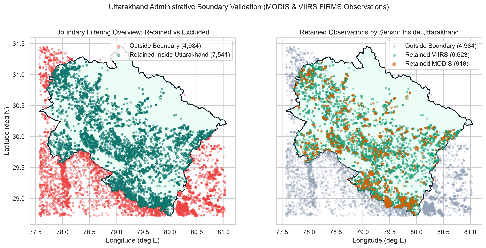
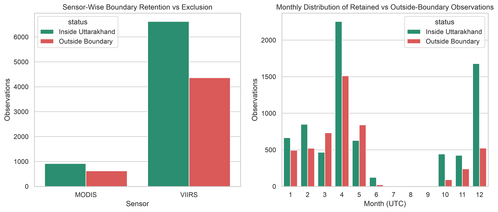

# FIREINTEL — Uttarakhand Administrative Boundary Validation Report

## 1. Boundary Data Source, Licence & Geometry Audit

- **Administrative Unit:** `Uttarākhand` (`IN-UT`, geoBoundaries ID `IND-ADM1-1811400`)
- **Source:** `DataMeet India community, Election Commission of India`
- **Licence:** `Creative Commons Attribution 2.5 India (CC BY 2.5 IN)`
- **Download URL:** `https://github.com/wmgeolab/geoBoundaries/raw/9469f09/releaseData/gbOpen/IND/ADM1/geoBoundaries-IND-ADM1.geojson`
- **Coordinate Reference System (CRS):** Original `EPSG:4326` -> Standardized `EPSG:4326` (WGS 84) for point-in-polygon filtering; projected to `EPSG:32644` (UTM Zone 44N) for metric area calculation.
- **Geometry Validation:** Type `Polygon`, Features `1`, Vertices `18,790`, Originally valid = `True` (`Valid Geometry`), Repair applied = `False`, Valid after check = `True`.
- **Polygon Extent & Area:** Bounds `(min_lon, min_lat, max_lon, max_lat) = (77.5723, 28.722895, 81.045287, 31.456127)`; Area = `53,417.95 km²`.

---

## 2. Filtering Summary (Original vs Retained Inside Uttarakhand)

| Dataset | Original (BBox) | Inside Uttarakhand | Outside Uttarakhand | Retained (%) | Excluded (%) | Active 0.05° Cells (Orig -> Retained) |
| --- | ---: | ---: | ---: | ---: | ---: | --- |
| Combined (`uttarakhand_fires`) | 12,525 | 7,541 | 4,984 | 60.21% | 39.79% | 2,019 -> 1,168 |
| MODIS (`uttarakhand_modis`) | 1,540 | 918 | 622 | 59.61% | 40.39% | 744 -> 458 |
| VIIRS (`uttarakhand_viirs`) | 10,985 | 6,623 | 4,362 | 60.29% | 39.71% | 1,967 -> 1,135 |

### Sensor-Wise Geographical Coverage

- **MODIS retained bounds:** `{'min_lat': 28.7322, 'max_lat': 31.2079, 'min_lon': 77.733, 'max_lon': 80.7225}` (excluded bounds: `{'min_lat': 28.7263, 'max_lat': 31.4391, 'min_lon': 77.5701, 'max_lon': 80.9965}`)
- **VIIRS retained bounds:** `{'min_lat': 28.73072, 'max_lat': 31.2063, 'min_lon': 77.71218, 'max_lon': 80.81789}` (excluded bounds: `{'min_lat': 28.72012, 'max_lat': 31.4461, 'min_lon': 77.57019, 'max_lon': 81.02911}`)
- **Combined retained bounds:** `{'min_lat': 28.73072, 'max_lat': 31.2079, 'min_lon': 77.71218, 'max_lon': 80.81789}`

---

## 3. Geographical Visualisations

---

## 4. Geographical Filtering Methodology

1. Load the Uttarakhand state polygon from `data/boundaries/uttarakhand_boundary.geojson` (`EPSG:4326`), validate polygon topology with Shapely (`is_valid` / `make_valid` if needed), and build a unified boundary geometry (`union_all()`).
2. Load `uttarakhand_fires.csv`, `uttarakhand_modis.csv`, and `uttarakhand_viirs.csv` read-only while preserving `acq_time` zero-padding, native `confidence` values, `sensor`, and UTC-aware `acq_datetime`.
3. Convert `(longitude, latitude)` points into a `GeoDataFrame` in `EPSG:4326` matching the boundary CRS.
4. Apply exact boundary-inclusive point-in-polygon testing via GeoPandas `points.covered_by(boundary_geom)` separately for MODIS, VIIRS, and Combined, verifying `MODIS + VIIRS == COMBINED`.
5. Persist validated CSVs under `data/processed/boundary_validated/` without modifying raw or prior bounding-box-filtered CSVs, then verify 100% containment on disk.

---

## 5. Limitations & Recommendations

- **Rectangular BBox Spillover:** Almost 40% (`4,984` of `12,525`) of the rectangular bounding-box points lay outside Uttarakhand's actual state borders (neighboring plains/regions in Uttar Pradesh, Himachal Pradesh, and across the international border). Removing them prevents non-Uttarakhand agricultural/crop burning from distorting Uttarakhand forest fire risk metrics.
- **Boundary Provenance Caveat:** The `geoBoundaries IND-ADM1` layer (derived from DataMeet / Election Commission of India) represents a publicly licensed state polygon (`CC BY 2.5 IN`) and aligns with standard open GIS datasets, though official national survey boundaries from Survey of India should be substituted if required for statutory/government reporting.
- **Pixel Footprint vs Point Centroid:** FIRMS coordinates represent pixel centers (`~375 m` VIIRS, `~1 km` MODIS). A fire straddling the state border can have its centroid slightly inside or outside the line.
- **Eastern Tip Coverage Note:** The polygon extends to `81.0453° E`, while the upstream bounding-box preprocessing filtered at `MAX_LON = 81.03° E` (excluding 1 raw VIIRS row at `81.03001° E`).
- **Recommendation:** Use `data/processed/boundary_validated/` for updated EDA (`reports/eda_boundary_validated/`), spatio-temporal fire event clustering, and all future modeling.
