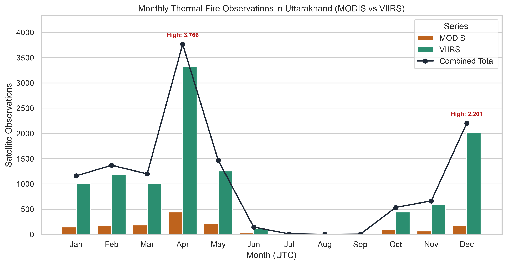
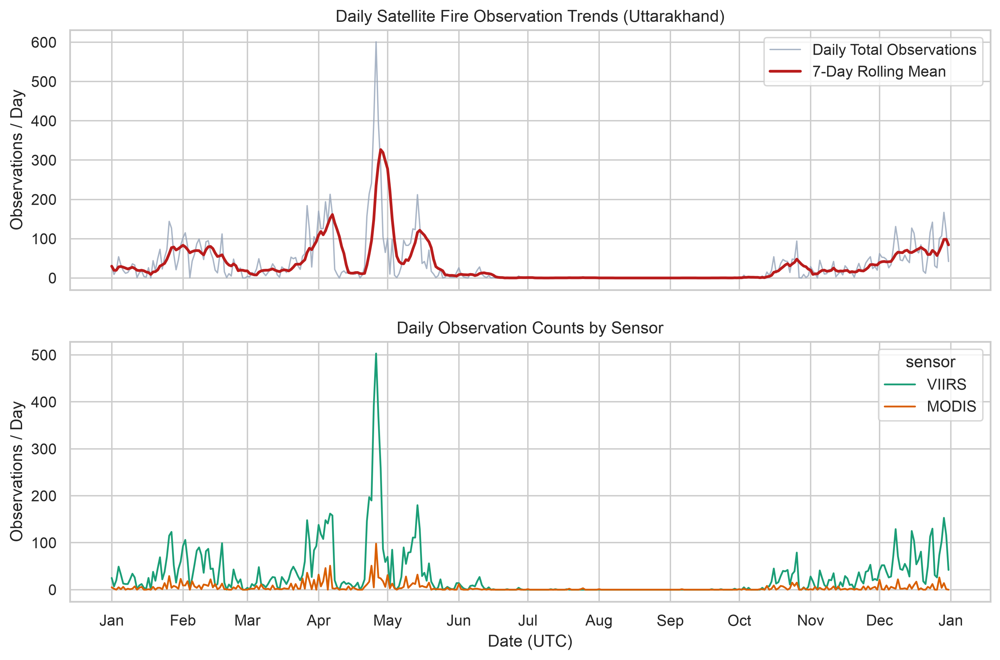
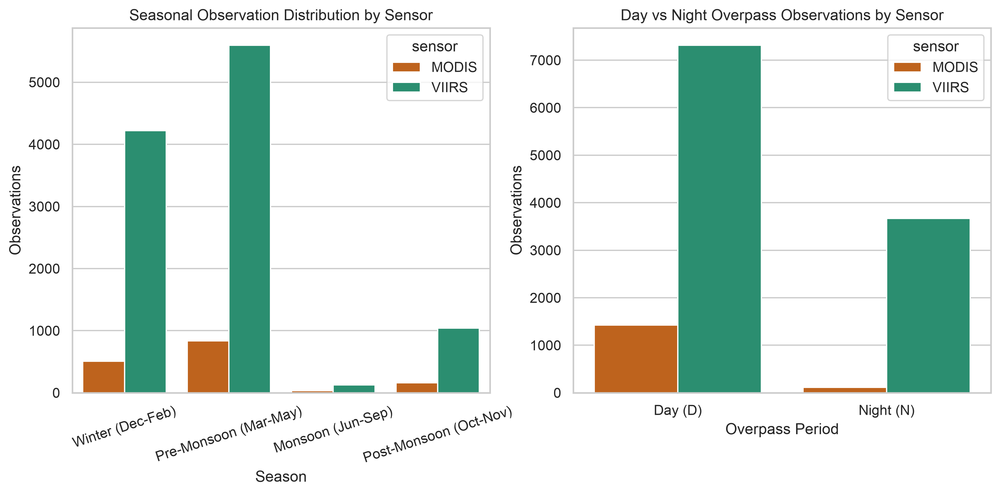
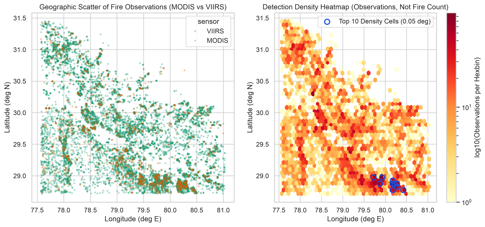
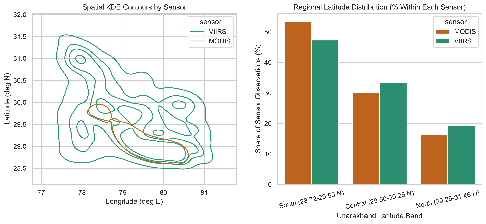
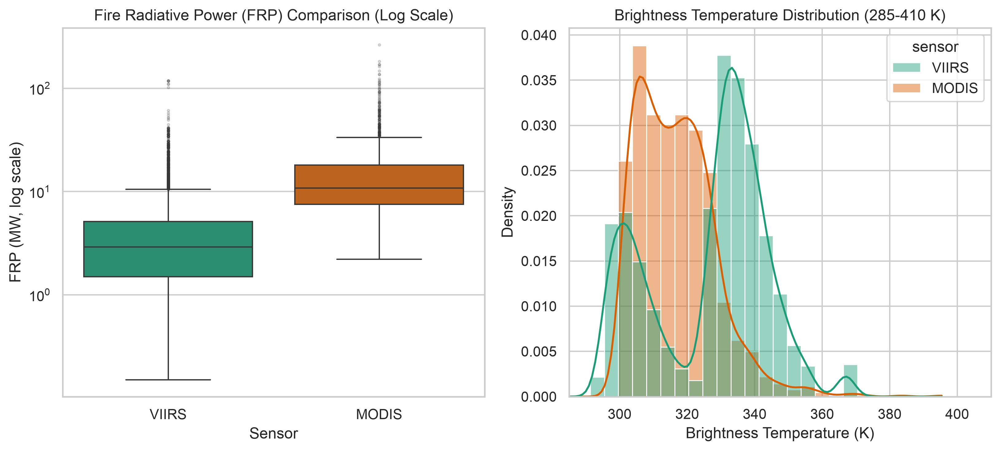
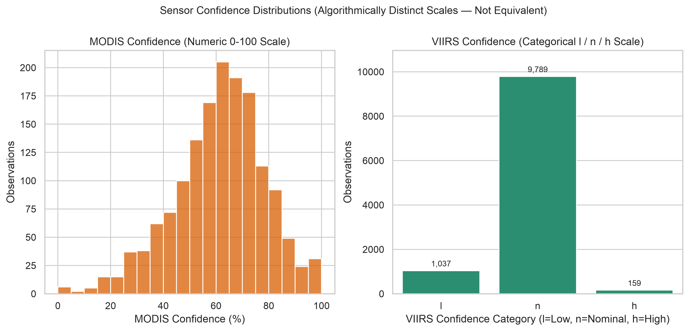
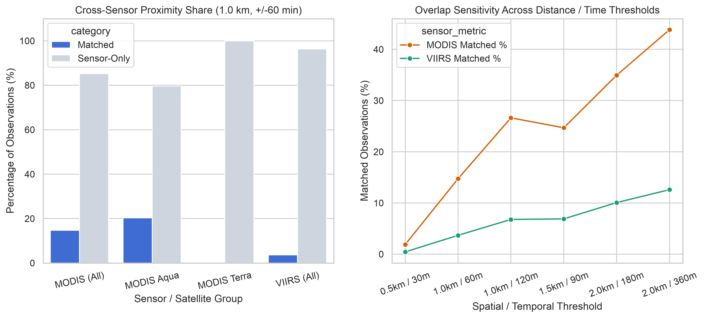

# FIREINTEL — Exploratory Data Analysis Report (Uttarakhand)

> **Core Analytical Disclaimer:** Every row in these datasets is a **satellite thermal anomaly observation** recorded during an orbital overpass, **not** a confirmed standalone wildfire incident. A single wildfire can generate multiple observations across consecutive days, adjacent 375 m VIIRS / 1 km MODIS pixels, or multiple satellites (`Aqua`, `Terra`, `SNPP`).

---

## 1. Dataset Characteristics & Overview

- **Total observations:** `12,525` (`VIIRS`: `10,985` / `87.7%`; `MODIS`: `1,540` / `12.3%`)
- **Date coverage (UTC):** `2025-01-01 07:43:00+00:00` to `2025-12-31 21:28:00+00:00` (`257` active detection days out of `365` calendar days; `108` zero-detection days)
- **Observation frequency:** `34.32` obs/calendar day (`48.74` obs/active day)
- **Missing values:** `0` missing cells across all columns in combined, MODIS, and VIIRS files
- **Unique geographical coordinates:** `12,525` exact `(latitude, longitude)` pairs (`MODIS`: `1,540`, `VIIRS`: `10,985` — satellite pixel centroids shift per overpass); `7,964` unique `0.01°` (~1.1 km) cells
- **Spatial extent:** latitude `28.7201` to `31.4461` deg N; longitude `77.5701` to `81.0291` deg E
- **Brightness temperature (K):** min `208.0`, median `330.21`, mean `325.4687`, max `395.4`
- **Fire Radiative Power (FRP, MW):** min `0.15`, Q25 `1.68`, median `3.4`, mean `5.8016`, P95 `18.178`, max `263.4`
- **Day vs Night (`daynight`):** Day `D` = `8,741` (`69.79%`), Night `N` = `3,784` (`30.21%`)

---

## 2. Temporal Patterns

- **Yearly coverage:** Single calendar year available (`2025`); multi-year trend analysis is not applicable.
- **Unusually high observation months** (exceeding monthly mean + 1 SD `2152.3` or IQR upper fence `3318.25`): **Apr (3,766 obs, z=2.46), Dec (2,201 obs, z=1.04)**.
- **Peak vs quietest month:** Peak = `Apr` (`3,766` obs, `30.07%`); Quietest = `Aug` (`1` obs, `0.01%`).
- **Daily single-day peak:** `2025-04-26` with `601` observations (`VIIRS`: `503`, `MODIS`: `98`).

### Monthly Analysis

| month | month_name | MODIS | VIIRS | total_observations | share_pct | modis_share_pct | z_score | above_mean_plus_1sd | above_iqr_fence |
| --- | --- | --- | --- | --- | --- | --- | --- | --- | --- |
| 1 | Jan | 145 | 1015 | 1160 | 9.26 | 12.5 | 0.1 | False | False |
| 2 | Feb | 182 | 1188 | 1370 | 10.94 | 13.28 | 0.29 | False | False |
| 3 | Mar | 185 | 1014 | 1199 | 9.57 | 15.43 | 0.14 | False | False |
| 4 | Apr | 441 | 3325 | 3766 | 30.07 | 11.71 | 2.46 | True | True |
| 5 | May | 211 | 1257 | 1468 | 11.72 | 14.37 | 0.38 | False | False |
| 6 | Jun | 25 | 121 | 146 | 1.17 | 17.12 | -0.81 | False | False |
| 7 | Jul | 7 | 3 | 10 | 0.08 | 70.0 | -0.93 | False | False |
| 8 | Aug | 1 | 0 | 1 | 0.01 | 100.0 | -0.94 | False | False |
| 9 | Sep | 1 | 4 | 5 | 0.04 | 20.0 | -0.94 | False | False |
| 10 | Oct | 92 | 443 | 535 | 4.27 | 17.2 | -0.46 | False | False |
| 11 | Nov | 68 | 596 | 664 | 5.3 | 10.24 | -0.34 | False | False |
| 12 | Dec | 182 | 2019 | 2201 | 17.57 | 8.27 | 1.04 | True | False |

### Seasonal & Day/Night Distribution

Seasons follow regional meteorological periods: **Winter** (Dec–Feb), **Pre-Monsoon** (Mar–May), **Monsoon** (Jun–Sep), and **Post-Monsoon** (Oct–Nov).

| season | MODIS | VIIRS | total | share_pct |
| --- | --- | --- | --- | --- |
| Winter (Dec-Feb) | 509 | 4222 | 4731 | 37.77 |
| Pre-Monsoon (Mar-May) | 837 | 5596 | 6433 | 51.36 |
| Monsoon (Jun-Sep) | 34 | 128 | 162 | 1.29 |
| Post-Monsoon (Oct-Nov) | 160 | 1039 | 1199 | 9.57 |

---

## 3. Geographical Hotspots & Spatial Analysis

> **Spatial Interpretation Caution:** Grid observation density reflects how frequently thermal anomalies were detected by satellites over that area; it does **not** directly equal the number of distinct fires or burned area size.

- **Grid concentration (`0.05°` cells, ~5.5 km):** `2,019` active cells (`434` with 1 observation; `378` with >= 10; `11` with >= 50).
- **Top-cell share:** Top 10 grid cells hold `4.73%` of all detections; top 20 hold `8.02%`.
- **Latitude bands:** `{'South (28.72-29.50 N)': 6025, 'Central (29.50-30.25 N)': 4142, 'North (30.25-31.46 N)': 2358}`
- **Longitude bands:** `{'West (77.57-78.75 E)': 4804, 'Central (78.75-79.90 E)': 4486, 'East (79.90-81.03 E)': 3235}`

### Top 10 Grid Cells by Observation Density (`0.05° × 0.05°`)

| rank | cell_center_lat | cell_center_lon | total_observations | modis_observations | viirs_observations | active_days | share_of_total_pct | mean_frp | max_frp |
| --- | --- | --- | --- | --- | --- | --- | --- | --- | --- |
| 1 | 28.875 | 80.175 | 103 | 22 | 81 | 6 | 0.82 | 15.19 | 60.72 |
| 2 | 28.875 | 79.875 | 57 | 6 | 51 | 23 | 0.46 | 5.33 | 16.1 |
| 3 | 28.875 | 80.275 | 56 | 9 | 47 | 15 | 0.45 | 14.17 | 117.13 |
| 4 | 28.975 | 79.925 | 56 | 6 | 50 | 15 | 0.45 | 9.08 | 52.7 |
| 5 | 28.925 | 80.175 | 56 | 7 | 49 | 7 | 0.45 | 9.35 | 66.8 |
| 6 | 28.825 | 80.275 | 55 | 12 | 43 | 10 | 0.44 | 23.81 | 182.5 |
| 7 | 28.975 | 79.725 | 54 | 10 | 44 | 27 | 0.43 | 8.0 | 40.5 |
| 8 | 28.775 | 80.175 | 52 | 9 | 43 | 27 | 0.42 | 9.62 | 57.69 |
| 9 | 28.875 | 80.225 | 52 | 8 | 44 | 11 | 0.42 | 18.04 | 110.9 |
| 10 | 28.775 | 80.425 | 51 | 6 | 45 | 10 | 0.41 | 8.17 | 57.6 |

---

## 4. MODIS vs VIIRS Sensor Comparison

- **Observation volume:** `VIIRS` (`10,985`) recorded `7.13x` more detections than `MODIS` (`1,540`), consistent with VIIRS's finer 375 m pixel resolution versus MODIS's 1 km pixel footprint.
- **Monthly trend correlation:** `r = 0.9639` between MODIS and VIIRS monthly observation counts.
- **Satellites:** `MODIS` = `{'Aqua': 1116, 'Terra': 424}`; `VIIRS` = `{'SNPP': 10985}`.
- **FRP contrast:** Median `MODIS` FRP (`10.8 MW`) is `3.71x` median `VIIRS` FRP (`2.91 MW`), reflecting larger MODIS pixel integration and higher minimum detectable fire intensity.

| metric | MODIS | VIIRS | unit |
| --- | --- | --- | --- |
| total_observations | 1540.0 | 10985.0 | observations |
| daytime_pct | 92.6 | 66.59 | percent |
| nighttime_pct | 7.4 | 33.41 | percent |
| brightness_min | 300.0 | 208.0 | K |
| brightness_median | 315.4 | 331.48 | K |
| brightness_mean | 316.6813 | 326.7006 | K |
| brightness_max | 395.4 | 367.0 | K |
| bright_t31_median | 298.4 | 296.33 | K |
| frp_median | 10.8 | 2.91 | MW |
| frp_mean | 16.8812 | 4.2484 | MW |
| frp_p95 | 48.455 | 11.778 | MW |
| frp_max | 263.4 | 118.12 | MW |
| lat_band_South (28.72-29.50 N) | 824.0 | 5201.0 | observations |
| lat_band_Central (29.50-30.25 N) | 464.0 | 3678.0 | observations |
| lat_band_North (30.25-31.46 N) | 252.0 | 2106.0 | observations |
| lon_band_West (77.57-78.75 E) | 554.0 | 4250.0 | observations |
| lon_band_Central (78.75-79.90 E) | 613.0 | 3873.0 | observations |
| lon_band_East (79.90-81.03 E) | 373.0 | 2862.0 | observations |

### Confidence Distributions (Strictly Separate Scales)

> **Non-Equivalence Warning:** MODIS numeric confidence (0-100) and VIIRS categorical confidence (l/n/h) are distinct retrieval scales and are never equated.

- **MODIS numeric confidence (0–100):** min `0.0`, Q25 `51.0`, median `62.0`, mean `60.8461`, Q75 `72.0`, max `100.0`; descriptive FIRMS ranges `<30` = `80`, `30–79` = `1,264`, `>=80` = `196`.
- **VIIRS categorical confidence (`l`/`n`/`h`):** counts = `{'l': 1037, 'n': 9789, 'h': 159}`, percentages = `{'l': 9.44, 'n': 89.11, 'h': 1.45}`.

---

## 5. Cross-Sensor Spatial-Temporal Overlap Analysis

Using great-circle Haversine distance `<= 1.0 km` and absolute UTC time difference `<= 60 min` (without deleting or merging any rows):

- **Candidate cross-sensor pairs:** `475`
- **MODIS matched vs MODIS-only:** `227` / `1,540` matched (`14.74%`), leaving `1,313` MODIS-only observations (`85.26%`).
- **VIIRS matched vs VIIRS-only:** `404` / `10,985` matched (`3.68%`), leaving `10,581` VIIRS-only observations (`96.32%`).
- **MODIS orbital timing split:** `Aqua` (`~13:30` local overpass, near Suomi-NPP) matched `227` (`20.34%`), whereas `Terra` (`~10:30` local overpass) matched `0` (`0.0%`) within `+/-60 min`.
- **Matched pair separation:** median distance `0.592 km`, median time delta `40.0 min`.

### Overlap Threshold Sensitivity

| distance_threshold_km | time_threshold_minutes | candidate_cross_sensor_pairs | modis_total | modis_matched | modis_only | modis_matched_pct | viirs_total | viirs_matched | viirs_only | viirs_matched_pct | aqua_matched | aqua_matched_pct | terra_matched | terra_matched_pct | median_pair_distance_km | median_pair_time_delta_min | is_primary_threshold |
| --- | --- | --- | --- | --- | --- | --- | --- | --- | --- | --- | --- | --- | --- | --- | --- | --- | --- |
| 0.5 | 30 | 48 | 1540 | 29 | 1511 | 1.88 | 10985 | 48 | 10937 | 0.44 | 29 | 2.6 | 0 | 0.0 | 0.338 | 18.0 | False |
| 1.0 | 60 | 475 | 1540 | 227 | 1313 | 14.74 | 10985 | 404 | 10581 | 3.68 | 227 | 20.34 | 0 | 0.0 | 0.592 | 40.0 | True |
| 1.0 | 120 | 930 | 1540 | 410 | 1130 | 26.62 | 10985 | 745 | 10240 | 6.78 | 410 | 36.74 | 0 | 0.0 | 0.608 | 58.0 | False |
| 1.5 | 90 | 1145 | 1540 | 380 | 1160 | 24.68 | 10985 | 757 | 10228 | 6.89 | 380 | 34.05 | 0 | 0.0 | 0.791 | 56.0 | False |
| 2.0 | 180 | 1889 | 1540 | 538 | 1002 | 34.94 | 10985 | 1106 | 9879 | 10.07 | 518 | 46.42 | 20 | 4.72 | 0.945 | 64.0 | False |
| 2.0 | 360 | 2471 | 1540 | 675 | 865 | 43.83 | 10985 | 1383 | 9602 | 12.59 | 518 | 46.42 | 157 | 37.03 | 0.935 | 75.0 | False |

**Overlap Methodology & Limitations:**
- Great-circle Haversine spatial proximity combined with absolute UTC acquisition time difference.
- MODIS Aqua (~13:30 local) orbits close to Suomi-NPP VIIRS (~13:30 local), whereas MODIS Terra (~10:30 local) is offset by ~3 hours and exhibits zero matches within +/-60 minutes.
- Because MODIS has ~1 km pixels and VIIRS has ~375 m pixels, one MODIS detection frequently overlaps multiple VIIRS pixels (many-to-one geometry).
- Spatial-temporal proximity alone does not confirm the same physical fire incident, nor does absence of a match imply false detection (cloud cover, swath edge, or fire duration between overpasses can prevent simultaneous detection).

---

## 6. Data Quality Audit

- **Missing values:** `0` missing cells across all columns.
- **Coordinate checks:** `0` globally invalid coordinates, `0` `(0, 0)` coordinates, `0` outside Uttarakhand bounding box.
- **Timestamp checks:** `0` `NaT` timestamps, `0` malformed `acq_time` entries, `0` `acq_date`/`acq_time` vs `acq_datetime` mismatches.
- **Duplicate checks:** `0` exact full-row duplicates; `0` same-`(sensor, lat, lon, acq_datetime)` duplicates.
- **Thermal & value checks:** `0` non-positive `frp` rows; `0` non-positive `scan`/`track` rows; unexpected `daynight` codes = `[]`.
- **FIRMS `type` flag & physical channel quirks:** MODIS includes `{0: 1515, 2: 25}` (`type=2` denotes static thermal/non-vegetation land sources in FIRMS C6.1, `25` rows); VIIRS has `{0: 10985}` (`all type=0`), `1` observation with `brightness < 250 K` (`208.0 K` I-4 channel fold on a high-FRP daytime detection), and `3` VIIRS rows where `brightness < bright_t31`.
- **Sensor schema inconsistencies:** VIIRS raw `instrument` field holds `['SNPP']` rather than `['VIIRS']` (handled via the normalized `sensor` column); `version` uses `{'MODIS': ['61.03'], 'VIIRS': ['2']}`; `confidence` uses incompatible numeric (`0–100`) vs categorical (`l`/`n`/`h`) schemas.

---

## 7. Limitations & Recommendations for Next Development Phase

### Key Limitations
1. **Single-year window (`2025`):** Inter-annual climate variability (e.g., drought vs wet years) cannot be modeled from one calendar year alone.
2. **Observations != fire incidents:** Adjacent 375 m VIIRS and 1 km MODIS pixels from the same fire inflate raw point counts in persistently burning areas.
3. **Missing environmental covariates:** FIRMS points alone lack land-cover, forest type, topography (slope/elevation), weather (temperature, RH, wind, VPD), and anthropogenic proximity.
4. **Non-vegetation thermal sources:** `25` MODIS detections are flagged `type=2` (static thermal land sources) and `3` VIIRS rows show `brightness < bright_t31` folding anomalies.

### Recommendations for Next Phase
1. **Spatio-temporal fire event clustering:** Group raw detections into discrete wildfire episodes (e.g., ST-DBSCAN / space-time connected components) while retaining raw observations for auditability and computing episode duration, peak FRP, and growth rate.
2. **Handle `type` & sensor quirks explicitly:** Flag or separate MODIS `type=2` static thermal anomalies before downstream forest fire risk modeling, and retain separate sensor-aware confidence handling rather than merging `0–100` and `l`/`n`/`h`.
3. **Expand multi-year & environmental context:** Ingest additional years (e.g., 2015–2024) plus Uttarakhand elevation/slope, forest cover, and ERA5 meteorological features onto a uniform spatial-temporal grid before training predictive ML models.
