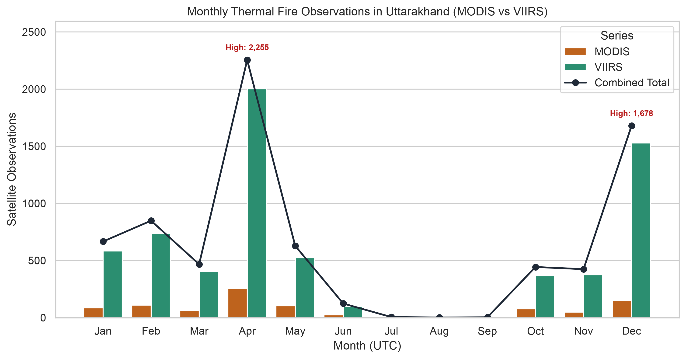
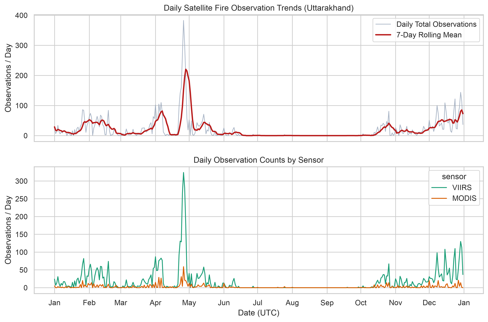
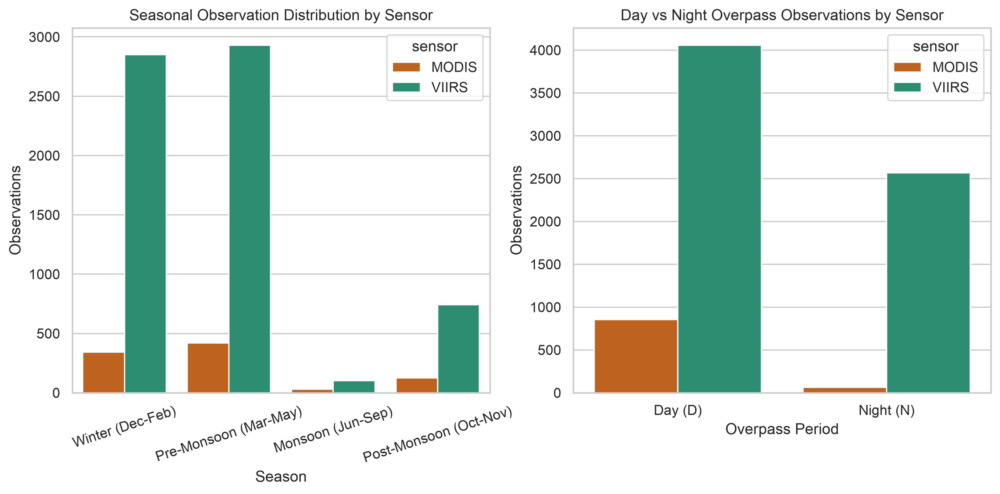
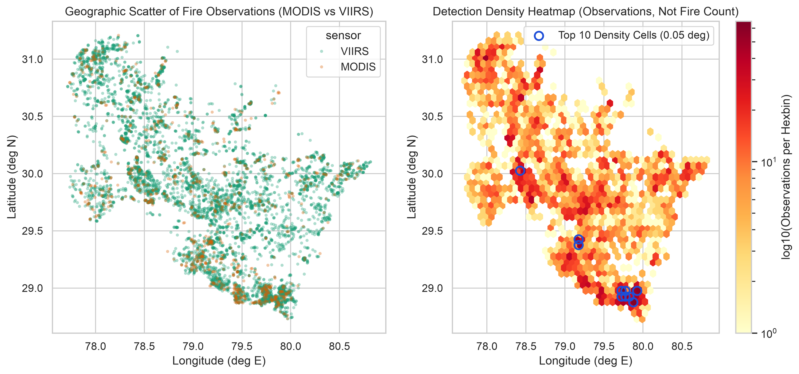
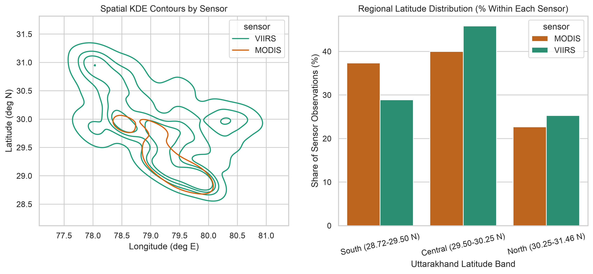
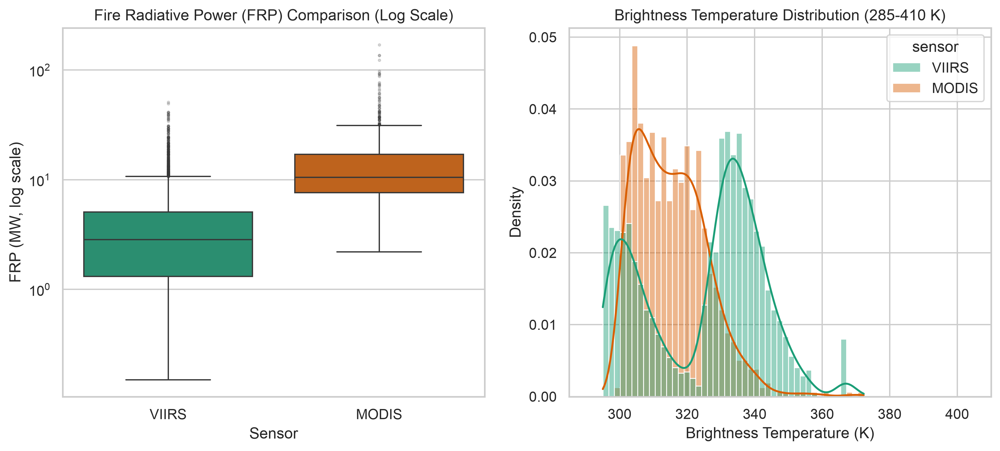
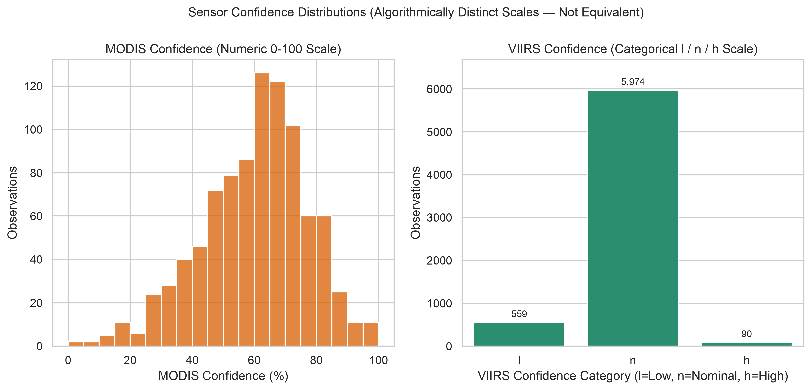
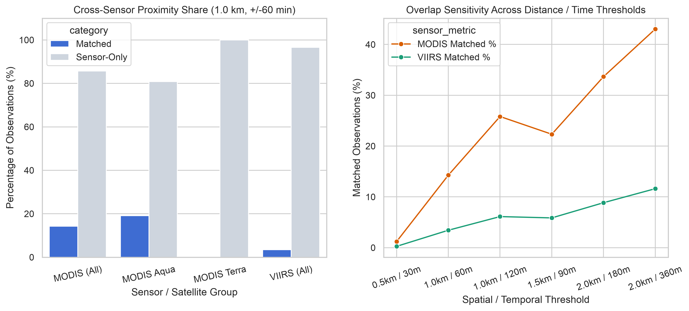

# FIREINTEL — Exploratory Data Analysis Report (Uttarakhand)

> **Core Analytical Disclaimer:** Every row in these datasets is a **satellite thermal anomaly observation** recorded during an orbital overpass, **not** a confirmed standalone wildfire incident. A single wildfire can generate multiple observations across consecutive days, adjacent 375 m VIIRS / 1 km MODIS pixels, or multiple satellites (`Aqua`, `Terra`, `SNPP`).

---

## 1. Dataset Characteristics & Overview

- **Total observations:** `7,541` (`VIIRS`: `6,623` / `87.83%`; `MODIS`: `918` / `12.17%`)
- **Date coverage (UTC):** `2025-01-01 07:43:00+00:00` to `2025-12-31 21:28:00+00:00` (`239` active detection days out of `365` calendar days; `126` zero-detection days)
- **Observation frequency:** `20.66` obs/calendar day (`31.55` obs/active day)
- **Missing values:** `0` missing cells across all columns in combined, MODIS, and VIIRS files
- **Unique geographical coordinates:** `7,541` exact `(latitude, longitude)` pairs (`MODIS`: `918`, `VIIRS`: `6,623` — satellite pixel centroids shift per overpass); `4,730` unique `0.01°` (~1.1 km) cells
- **Spatial extent:** latitude `28.7307` to `31.2079` deg N; longitude `77.7122` to `80.8179` deg E
- **Brightness temperature (K):** min `295.0`, median `328.6`, mean `323.7342`, max `372.3`
- **Fire Radiative Power (FRP, MW):** min `0.15`, Q25 `1.5`, median `3.36`, mean `5.3497`, P95 `16.3`, max `169.9`
- **Day vs Night (`daynight`):** Day `D` = `4,911` (`65.12%`), Night `N` = `2,630` (`34.88%`)

---

## 2. Temporal Patterns

- **Yearly coverage:** Single calendar year available (`2025`); multi-year trend analysis is not applicable.
- **Unusually high observation months** (exceeding monthly mean + 1 SD `1324.4` or IQR upper fence `1638.5`): **Apr (2,255 obs, z=2.34), Dec (1,678 obs, z=1.51)**.
- **Peak vs quietest month:** Peak = `Apr` (`2,255` obs, `29.9%`); Quietest = `Aug` (`1` obs, `0.01%`).
- **Daily single-day peak:** `2025-04-26` with `383` observations (`VIIRS`: `324`, `MODIS`: `59`).

### Monthly Analysis

| month | month_name | MODIS | VIIRS | total_observations | share_pct | modis_share_pct | z_score | above_mean_plus_1sd | above_iqr_fence |
| --- | --- | --- | --- | --- | --- | --- | --- | --- | --- |
| 1 | Jan | 84 | 582 | 666 | 8.83 | 12.61 | 0.05 | False | False |
| 2 | Feb | 109 | 739 | 848 | 11.25 | 12.85 | 0.32 | False | False |
| 3 | Mar | 62 | 405 | 467 | 6.19 | 13.28 | -0.23 | False | False |
| 4 | Apr | 254 | 2001 | 2255 | 29.9 | 11.26 | 2.34 | True | True |
| 5 | May | 104 | 524 | 628 | 8.33 | 16.56 | -0.0 | False | False |
| 6 | Jun | 23 | 100 | 123 | 1.63 | 18.7 | -0.73 | False | False |
| 7 | Jul | 5 | 0 | 5 | 0.07 | 100.0 | -0.9 | False | False |
| 8 | Aug | 1 | 0 | 1 | 0.01 | 100.0 | -0.9 | False | False |
| 9 | Sep | 0 | 3 | 3 | 0.04 | 0.0 | -0.9 | False | False |
| 10 | Oct | 77 | 366 | 443 | 5.87 | 17.38 | -0.27 | False | False |
| 11 | Nov | 49 | 375 | 424 | 5.62 | 11.56 | -0.29 | False | False |
| 12 | Dec | 150 | 1528 | 1678 | 22.25 | 8.94 | 1.51 | True | True |

### Seasonal & Day/Night Distribution

Seasons follow regional meteorological periods: **Winter** (Dec–Feb), **Pre-Monsoon** (Mar–May), **Monsoon** (Jun–Sep), and **Post-Monsoon** (Oct–Nov).

| season | MODIS | VIIRS | total | share_pct |
| --- | --- | --- | --- | --- |
| Winter (Dec-Feb) | 343 | 2849 | 3192 | 42.33 |
| Pre-Monsoon (Mar-May) | 420 | 2930 | 3350 | 44.42 |
| Monsoon (Jun-Sep) | 29 | 103 | 132 | 1.75 |
| Post-Monsoon (Oct-Nov) | 126 | 741 | 867 | 11.5 |

---

## 3. Geographical Hotspots & Spatial Analysis

> **Spatial Interpretation Caution:** Grid observation density reflects how frequently thermal anomalies were detected by satellites over that area; it does **not** directly equal the number of distinct fires or burned area size.

- **Grid concentration (`0.05°` cells, ~5.5 km):** `1,168` active cells (`234` with 1 observation; `235` with >= 10; `4` with >= 50).
- **Top-cell share:** Top 10 grid cells hold `5.83%` of all detections; top 20 hold `10.16%`.
- **Latitude bands:** `{'South (28.72-29.50 N)': 2256, 'Central (29.50-30.25 N)': 3403, 'North (30.25-31.46 N)': 1882}`
- **Longitude bands:** `{'West (77.57-78.75 E)': 2603, 'Central (78.75-79.90 E)': 3763, 'East (79.90-81.03 E)': 1175}`

### Top 10 Grid Cells by Observation Density (`0.05° × 0.05°`)

| rank | cell_center_lat | cell_center_lon | total_observations | modis_observations | viirs_observations | active_days | share_of_total_pct | mean_frp | max_frp |
| --- | --- | --- | --- | --- | --- | --- | --- | --- | --- |
| 1 | 28.875 | 79.875 | 57 | 6 | 51 | 23 | 0.76 | 5.33 | 16.1 |
| 2 | 28.975 | 79.925 | 56 | 6 | 50 | 15 | 0.74 | 9.08 | 52.7 |
| 3 | 28.975 | 79.725 | 54 | 10 | 44 | 27 | 0.72 | 8.0 | 40.5 |
| 4 | 29.425 | 79.175 | 51 | 8 | 43 | 7 | 0.68 | 3.88 | 28.9 |
| 5 | 29.375 | 79.175 | 39 | 7 | 32 | 10 | 0.52 | 4.06 | 13.2 |
| 6 | 30.025 | 78.425 | 39 | 2 | 37 | 6 | 0.52 | 4.98 | 26.5 |
| 7 | 28.975 | 79.775 | 38 | 8 | 30 | 16 | 0.5 | 7.01 | 34.9 |
| 8 | 28.925 | 79.775 | 37 | 4 | 33 | 18 | 0.49 | 5.39 | 32.5 |
| 9 | 28.925 | 79.825 | 35 | 7 | 28 | 19 | 0.46 | 6.4 | 28.4 |
| 10 | 28.925 | 79.725 | 34 | 5 | 29 | 17 | 0.45 | 6.08 | 30.0 |

---

## 4. MODIS vs VIIRS Sensor Comparison

- **Observation volume:** `VIIRS` (`6,623`) recorded `7.21x` more detections than `MODIS` (`918`), consistent with VIIRS's finer 375 m pixel resolution versus MODIS's 1 km pixel footprint.
- **Monthly trend correlation:** `r = 0.969` between MODIS and VIIRS monthly observation counts.
- **Satellites:** `MODIS` = `{'Aqua': 684, 'Terra': 234}`; `VIIRS` = `{'SNPP': 6623}`.
- **FRP contrast:** Median `MODIS` FRP (`10.55 MW`) is `3.7x` median `VIIRS` FRP (`2.85 MW`), reflecting larger MODIS pixel integration and higher minimum detectable fire intensity.

| metric | MODIS | VIIRS | unit |
| --- | --- | --- | --- |
| total_observations | 918.0 | 6623.0 | observations |
| daytime_pct | 93.03 | 61.26 | percent |
| nighttime_pct | 6.97 | 38.74 | percent |
| brightness_min | 300.1 | 295.0 | K |
| brightness_median | 314.2 | 330.54 | K |
| brightness_mean | 315.3821 | 324.8919 | K |
| brightness_max | 372.3 | 367.0 | K |
| bright_t31_median | 297.6 | 294.84 | K |
| frp_median | 10.55 | 2.85 | MW |
| frp_mean | 15.2717 | 3.9744 | MW |
| frp_p95 | 37.79 | 10.9 | MW |
| frp_max | 169.9 | 51.1 | MW |
| lat_band_South (28.72-29.50 N) | 343.0 | 1913.0 | observations |
| lat_band_Central (29.50-30.25 N) | 367.0 | 3036.0 | observations |
| lat_band_North (30.25-31.46 N) | 208.0 | 1674.0 | observations |
| lon_band_West (77.57-78.75 E) | 299.0 | 2304.0 | observations |
| lon_band_Central (78.75-79.90 E) | 509.0 | 3254.0 | observations |
| lon_band_East (79.90-81.03 E) | 110.0 | 1065.0 | observations |

### Confidence Distributions (Strictly Separate Scales)

> **Non-Equivalence Warning:** MODIS numeric confidence (0-100) and VIIRS categorical confidence (l/n/h) are distinct retrieval scales and are never equated.

- **MODIS numeric confidence (0–100):** min `0.0`, Q25 `49.0`, median `62.0`, mean `59.7691`, Q75 `71.0`, max `100.0`; descriptive FIRMS ranges `<30` = `50`, `30–79` = `761`, `>=80` = `107`.
- **VIIRS categorical confidence (`l`/`n`/`h`):** counts = `{'l': 559, 'n': 5974, 'h': 90}`, percentages = `{'l': 8.44, 'n': 90.2, 'h': 1.36}`.

---

## 5. Cross-Sensor Spatial-Temporal Overlap Analysis

Using great-circle Haversine distance `<= 1.0 km` and absolute UTC time difference `<= 60 min` (without deleting or merging any rows):

- **Candidate cross-sensor pairs:** `256`
- **MODIS matched vs MODIS-only:** `131` / `918` matched (`14.27%`), leaving `787` MODIS-only observations (`85.73%`).
- **VIIRS matched vs VIIRS-only:** `227` / `6,623` matched (`3.43%`), leaving `6,396` VIIRS-only observations (`96.57%`).
- **MODIS orbital timing split:** `Aqua` (`~13:30` local overpass, near Suomi-NPP) matched `131` (`19.15%`), whereas `Terra` (`~10:30` local overpass) matched `0` (`0.0%`) within `+/-60 min`.
- **Matched pair separation:** median distance `0.592 km`, median time delta `43.0 min`.

### Overlap Threshold Sensitivity

| distance_threshold_km | time_threshold_minutes | candidate_cross_sensor_pairs | modis_total | modis_matched | modis_only | modis_matched_pct | viirs_total | viirs_matched | viirs_only | viirs_matched_pct | aqua_matched | aqua_matched_pct | terra_matched | terra_matched_pct | median_pair_distance_km | median_pair_time_delta_min | is_primary_threshold |
| --- | --- | --- | --- | --- | --- | --- | --- | --- | --- | --- | --- | --- | --- | --- | --- | --- | --- |
| 0.5 | 30 | 17 | 918 | 11 | 907 | 1.2 | 6623 | 17 | 6606 | 0.26 | 11 | 1.61 | 0 | 0.0 | 0.34 | 18.0 | False |
| 1.0 | 60 | 256 | 918 | 131 | 787 | 14.27 | 6623 | 227 | 6396 | 3.43 | 131 | 19.15 | 0 | 0.0 | 0.592 | 43.0 | True |
| 1.0 | 120 | 471 | 918 | 237 | 681 | 25.82 | 6623 | 405 | 6218 | 6.12 | 237 | 34.65 | 0 | 0.0 | 0.585 | 57.0 | False |
| 1.5 | 90 | 460 | 918 | 205 | 713 | 22.33 | 6623 | 388 | 6235 | 5.86 | 205 | 29.97 | 0 | 0.0 | 0.718 | 52.0 | False |
| 2.0 | 180 | 766 | 918 | 309 | 609 | 33.66 | 6623 | 586 | 6037 | 8.85 | 299 | 43.71 | 10 | 4.27 | 0.777 | 60.0 | False |
| 2.0 | 360 | 1093 | 918 | 395 | 523 | 43.03 | 6623 | 769 | 5854 | 11.61 | 299 | 43.71 | 96 | 41.03 | 0.783 | 92.0 | False |

**Overlap Methodology & Limitations:**
- Great-circle Haversine spatial proximity combined with absolute UTC acquisition time difference.
- MODIS Aqua (~13:30 local) orbits close to Suomi-NPP VIIRS (~13:30 local), whereas MODIS Terra (~10:30 local) is offset by ~3 hours and exhibits zero matches within +/-60 minutes.
- Because MODIS has ~1 km pixels and VIIRS has ~375 m pixels, one MODIS detection frequently overlaps multiple VIIRS pixels (many-to-one geometry).
- Spatial-temporal proximity alone does not confirm the same physical fire incident, nor does absence of a match imply false detection (cloud cover, swath edge, or fire duration between overpasses can prevent simultaneous detection).

---

## 6. Data Quality Audit

- **Missing values:** `0` missing cells across all columns.
- **Coordinate checks:** `0` globally invalid coordinates, `0` `(0, 0)` coordinates, `0` outside Uttarakhand bounding box.
- **Timestamp checks:** `0` `NaT` timestamps, `0` malformed `acq_time` entries, `0` `acq_date`/`acq_time` vs `acq_datetime` mismatches.
- **Duplicate checks:** `0` exact full-row duplicates; `0` same-`(sensor, lat, lon, acq_datetime)` duplicates.
- **Thermal & value checks:** `0` non-positive `frp` rows; `0` non-positive `scan`/`track` rows; unexpected `daynight` codes = `[]`.
- **FIRMS `type` flag & physical channel quirks:** MODIS includes `{0: 904, 2: 14}` (`type=2` denotes static thermal/non-vegetation land sources in FIRMS C6.1: `14` rows); VIIRS has `{0: 6623}`, `0` observations with `brightness < 250 K` (I-4 channel fold), and `0` VIIRS rows where `brightness < bright_t31`.
- **Sensor schema inconsistencies:** VIIRS raw `instrument` field holds `['SNPP']` rather than `['VIIRS']` (handled via the normalized `sensor` column); `version` uses `{'MODIS': ['61.03'], 'VIIRS': ['2']}`; `confidence` uses incompatible numeric (`0–100`) vs categorical (`l`/`n`/`h`) schemas.

---

## 7. Limitations & Recommendations for Next Development Phase

### Key Limitations
1. **Calendar window (`2025`):** Inter-annual climate variability (e.g., drought vs wet years) cannot be modeled from a single year alone.
2. **Observations != fire incidents:** Adjacent 375 m VIIRS and 1 km MODIS pixels from the same fire inflate raw point counts in persistently burning areas.
3. **Missing environmental covariates:** FIRMS points alone lack land-cover, forest type, topography (slope/elevation), weather (temperature, RH, wind, VPD), and anthropogenic proximity.
4. **Non-vegetation & channel anomalies:** `14` MODIS detections are flagged `type=2` (static thermal land sources) and `0` VIIRS rows show `brightness < bright_t31` inversions.

### Recommendations for Next Phase
1. **Spatio-temporal fire event clustering:** Group raw detections into discrete wildfire episodes (e.g., ST-DBSCAN / space-time connected components) while retaining raw observations for auditability and computing episode duration, peak FRP, and growth rate.
2. **Handle `type` & sensor quirks explicitly:** Flag or separate MODIS `type=2` static thermal anomalies before downstream forest fire risk modeling, and retain separate sensor-aware confidence handling rather than merging `0–100` and `l`/`n`/`h`.
3. **Expand multi-year & environmental context:** Ingest additional years (e.g., 2015–2024) plus Uttarakhand elevation/slope, forest cover, and ERA5 meteorological features onto a uniform spatial-temporal grid before training predictive ML models.
