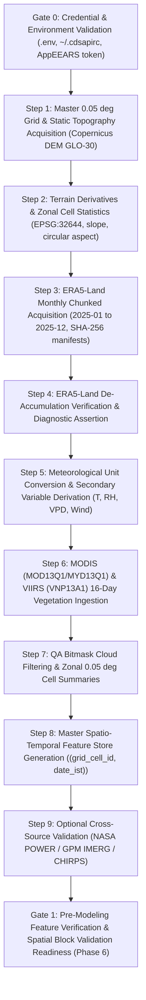

# FIREINTEL — Data Acquisition & Pipeline Implementation Plan

**Phase:** Phase 5A: Environmental Data Acquisition Architecture & Pipeline Preparation  
**Target Domain:** Uttarakhand, India (`IN-UT`, `53,417.95 km²` in `EPSG:32644`)  
**Study Horizon:** 1 January 2025 – 31 December 2025 (`UTC`)  
**Status:** Implementation Blueprint & Execution Order (No downloads permitted in Phase 5A)

---

## 1. Executive Implementation Roadmap

The transition from feasibility audit (Phase 4) and architecture design (Phase 5A) to operational data ingestion (Phase 5B) must follow a strict, phased execution sequence. Each step is gated by explicit technical entry criteria and automated validation assertions.

---

## 2. Step-by-Step Execution Sequence

### Step 1: Master Grid Generation & Static Terrain Ingestion
- **Objective:** Establish the spatial reference grid and ingest the static topographic surface before handling time-varying atmospheric fields.
- **Actions:**
  1. Generate the canonical Master `0.05°` Analysis Grid (`2,174` boundary-intersecting cells, `2,000` centroid-inside cells) from [uttarakhand_boundary.geojson](file:///Users/macbook/Documents/Nasa_Space_Hackathon/fireIntel/data/boundaries/uttarakhand_boundary.geojson).
  2. Compute cell-level boundary overlap fraction `uttarakhand_area_fraction` in metric planar CRS **`EPSG:32644` (UTM Zone 44N)**.
  3. Ingest **Copernicus DEM GLO-30** (`COP30`, 30m resolution, EGM2008 vertical datum) over Uttarakhand bounding box (`77.57°E–81.05°E`, `28.72°N–31.46°N`) via AWS Open Data S3 (`copernicus-dem-30m`) or OpenTopography Global Datasets API.
  4. Fallback: If Copernicus DEM access is throttled, ingest **NASA SRTMGL1 v003** (30m, EGM96).
- **Verification Gate:** Verify raster is non-empty, vertical units are metres above sea level, and coordinate reference system matches `EPSG:4326`.

### Step 2: Terrain Metric Derivation & Zonal Grid Aggregation
- **Objective:** Compute slope, circular aspect, and relief metrics in a metric planar coordinate system.
- **Actions:**
  1. Reproject DEM raster to planar `EPSG:32644` using bilinear interpolation.
  2. Compute physical slope (degrees) using Horn’s formula in metric metres ($x, y, z$ all in metres).
  3. Compute aspect (degrees from North) and decompose into circular components $\sin(\text{aspect})$ and $\cos(\text{aspect})$.
  4. Calculate the fraction of cell area with south-to-southwest exposure ($135° \le \text{aspect} \le 225°$).
  5. Calculate zonal statistics per `0.05°` cell: `elevation_mean_m`, `elevation_std_m`, `elevation_min_m`, `elevation_max_m`, `slope_mean_deg`, `slope_max_deg`, `aspect_sin_mean`, `aspect_cos_mean`, `south_facing_fraction`.
  6. Save output as `fireIntel/data/environmental/processed/static_terrain_005deg.parquet`.
- **Verification Gate:** Confirm standard deviation of elevation is $>0$ across Himalayan cells, slope is non-negative ($\ge 0°$), and no NaN values exist inside Uttarakhand's boundary.

### Step 3: ERA5-Land Monthly Chunked Ingestion
- **Objective:** Download complete hourly atmospheric and soil moisture reanalysis for 2025 from the Copernicus Climate Data Store (CDS).
- **Actions:**
  1. Utilize the `cdsapi` client configured with `~/.cdsapirc` or environment variables `CDSAPI_URL` and `CDSAPI_KEY`.
  2. Execute 12 monthly requests (January 2025 to December 2025) over bounding box `[31.5, 77.5, 28.7, 81.1]`.
  3. Request the 9 core variables: `2m_temperature`, `2m_dewpoint_temperature`, `10m_u_component_of_wind`, `10m_v_component_of_wind`, `total_precipitation`, `volumetric_soil_water_layer_1`, `volumetric_soil_water_layer_2`, `volumetric_soil_water_layer_3`, `volumetric_soil_water_layer_4`.
  4. Write downloads to temporary `.part` files, verify NetCDF header integrity with `xarray`, compute SHA-256 checksum, and atomically rename to `fireIntel/data/environmental/raw/era5_land/era5_land_2025_{month:02d}.nc`.
  5. Record request metadata and checksums in `fireIntel/data/environmental/manifests/era5_land_2025_manifest.json`.
- **Verification Gate:** Verify each monthly file contains $N_{\text{days}} \times 24$ hourly steps (744 hours for 31-day months, 720 for 30-day months, 672 for February 2025; total 8,760 hours for 2025).

### Step 4: ERA5-Land De-Accumulation Verification & Diagnostic Assertion
- **Objective:** Verify the upstream accumulation convention on actual downloaded data before performing precipitation de-accumulation.
- **Actions:**
  1. Inspect the first 48 hours of downloaded precipitation (`tp`) at 5 reference stations across elevation zones.
  2. Test for monotonic accumulation: check if $P(H) \ge P(H-1)$ throughout hours 01:00 to 23:00 UTC and verify whether a reset occurs at 00:00 UTC.
  3. If accumulation from 00:00 UTC is confirmed, apply the official de-accumulation formula:
     $$\Delta P_H = \begin{cases} P_{01:00} \times 1000.0 & \text{for } H = 01:00\text{ UTC} \\ \max(0.0, P_H - P_{H-1}) \times 1000.0 & \text{for } H \in \{02:00, \dots, 23:00\}\text{ UTC or } 00:00\text{ UTC (cycle end)} \end{cases}$$
  4. If values are already de-accumulated in the upstream stream, record this status in the manifest and bypass secondary subtraction.
  5. Save intermediate de-accumulated precipitation hourly arrays in `fireIntel/data/environmental/intermediate/era5_land_hourly/`.
- **Verification Gate:** Run automated assertion: $\Delta P_H \ge 0.0\text{ mm}$ for all grid points and timesteps; daily sum of $\Delta P_H$ matches the 24:00 accumulated step within floating-point tolerance ($< 0.01\text{ mm}$).

### Step 5: Meteorological Unit Conversion & Thermodynamic Derivations
- **Objective:** Convert raw physical variables into standardized fire-weather indicators.
- **Actions:**
  1. Convert temperature: $T_{°C} = T_K - 273.15$.
  2. Convert dewpoint: $T_{d,°C} = T_{d,K} - 273.15$.
  3. Compute saturation vapor pressure $e_s(T)$ and actual vapor pressure $e_a(T_d)$ via Magnus-Tetens Alduchov-Eskridge formula.
  4. Derive Relative Humidity ($RH = 100 \times e_a / e_s$) and Vapor Pressure Deficit ($VPD = e_s - e_a$).
  5. Compute wind speed $WS = \sqrt{u_{10}^2 + v_{10}^2}$ and meteorological wind direction $\text{Dir} = (\text{atan2}(-u, -v) \times 180/\pi) \pmod{360°}$.
  6. Preserve volumetric soil water fractions ($m^3/m^3$) across Layers 1–4.
  7. Map each `0.05°` cell to its parent `0.1°` ERA5-Land grid node using the nearest centroid formula: $\text{parent\_lat} = \text{round}(\text{centroid\_lat}, 1)$, $\text{parent\_lon} = \text{round}(\text{centroid\_lon}, 1)$.
- **Verification Gate:** Confirm $0 \le RH \le 100\%$, $VPD \ge 0\text{ kPa}$, $WS \ge 0\text{ m/s}$, and soil water fractions fall within $[0.0, 0.65]$.

### Step 6: Vegetation Index Ingestion & Quality Filtering
- **Objective:** Ingest 16-day MODIS (`MOD13Q1` / `MYD13Q1`) and VIIRS (`VNP13A1`) composites and apply rigorous cloud masking.
- **Actions:**
  1. Submit polygon extraction request to NASA AppEEARS API using [uttarakhand_boundary.geojson](file:///Users/macbook/Documents/Nasa_Space_Hackathon/fireIntel/data/boundaries/uttarakhand_boundary.geojson) for 2025.
  2. Download resulting GeoTIFF layers: `250m_16_days_NDVI`, `250m_16_days_EVI`, `250m_16_days_VI_Quality`, `250m_16_days_pixel_reliability`, `250m_16_days_composite_day_of_the_year`.
  3. Apply quality mask: retain only pixels where `pixel_reliability` $\in \{0, 1\}$ (Good or Marginal data) and bitmask confirms clear-sky (no cloud, shadow, or heavy aerosol).
  4. Compute zonal statistics per `0.05°` cell: `ndvi_mean`, `ndvi_p25`, `evi_mean`, `valid_pixel_fraction`.
  5. Map composites strictly by **composite end date plus 3 days delivery latency**: a composite covering April 7–22 is available for modeling only on or after April 25.
- **Verification Gate:** Verify NDVI and EVI scale factors ($0.0001$) produce valid vegetation values within $[-0.2, 1.0]$.

### Step 7: Master Spatio-Temporal Feature Store Assembly
- **Objective:** Combine static terrain, daily IST meteorological aggregates, antecedent moisture memory, and causal vegetation status into a unified feature store indexed by `(grid_cell_id, date_ist)`.
- **Actions:**
  1. For each IST calendar day $D$ and each `0.05°` cell $c$:
     - Aggregate weather over preceding IST day $D-1$: `temp_max_ist_d1`, `temp_min_ist_d1`, `temp_mean_ist_d1`, `rh_min_ist_d1`, `rh_mean_ist_d1`, `vpd_max_ist_d1`, `wind_speed_max_ist_d1`, `precip_total_ist_d1`.
     - Compute antecedent rainfall sums: 3-day ($D-3$ to $D-1$), 7-day ($D-7$ to $D-1$), 14-day ($D-14$ to $D-1$), and `consecutive_dry_days`.
     - Attach soil moisture levels at cutoff $T_0$ (`18:30 UTC [D-1]` / `00:00 IST [D]`) and 7-day delta.
     - Attach latest causally valid vegetation index where $\text{composite\_end} + 3\text{d} \le T_0$.
     - Attach static terrain features (`elevation_mean_m`, `slope_mean_deg`, `aspect_sin_mean`, etc.).
  2. Partition by `year` and `month` and store as Parquet in `fireIntel/data/environmental/processed/feature_store/`.
- **Verification Gate:** Assert zero records have feature timestamps $> T_0$. Check that all `2,174` intersecting cells have records for all 365 days of 2025 ($2,174 \times 365 = 793,510$ cell-day rows).

### Step 8: Optional Cross-Source Validation
- **Objective:** Cross-validate ERA5-Land rainfall against independent precipitation products.
- **Actions:**
  1. Retrieve monthly sample grids from NASA POWER (`PRECTOTCORR`), GPM IMERG (`precipitation`), and CHIRPS (`precipitation`).
  2. Calculate spatial correlation across foothill and mid-elevation zones to detect any regional precipitation bias in ERA5-Land.
  3. Output cross-validation findings to `fireIntel/reports/environmental_acquisition/cross_source_validation_report.md`.

---

## 3. Dependencies & Prerequisites

| Component | Upstream Prerequisite | Software / Library Required | System Resource Requirements |
| :--- | :--- | :--- | :--- |
| **CDS API Access** | Registered CDS account + license accepted | `cdsapi >= 0.7.0` | Network access, ~15 GB disk space for raw NetCDF |
| **NASA AppEEARS** | NASA Earthdata Login credentials | `requests >= 2.31.0` | Network access, ~5 GB disk space for GeoTIFFs |
| **Raster Processing** | None (local execution) | `rasterio >= 1.3.0`, `gdal`, `shapely >= 2.0` | 8 GB RAM, multi-core CPU for metric slope reprojection |
| **NetCDF Analytics** | Raw NetCDF files downloaded | `xarray >= 2024.1.0`, `netcdf4 >= 1.6.5` | 8 GB RAM |
| **Feature Store** | Processed intermediate datasets | `pandas >= 2.0.0`, `pyarrow >= 14.0.0` | ~2 GB disk space for compressed Parquet |

---

## 4. Risk Matrix & Concrete Engineering Mitigations

| Risk ID | Risk Description | Severity | Likelihood | Concrete Engineering Mitigation |
| :---: | :--- | :---: | :---: | :--- |
| **R-01** | **CDS API Queue Congestion / Rate Limiting:** Copernicus CDS requests can queue for hours during peak traffic or fail with HTTP 500/504 errors. | High | High | Implement asynchronous polling with exponential backoff and jitter; chunk requests into 12 single-month files rather than one giant annual request; support automatic resume using download manifests. |
| **R-02** | **Precipitation De-accumulation Misinterpretation:** Applying de-accumulation formulas to an already de-accumulated feed or misinterpreting the 00:00 UTC reset will corrupt rainfall features. | Critical | Medium | Implement an automated diagnostic inspection script on the first 48 hours of raw data to verify monotonic accumulation before applying $\Delta P_H$; run unit tests asserting $\Delta P_H \ge 0.0\text{ mm}$ and conservation of daily totals. |
| **R-03** | **Temporal Data Leakage:** Using same-day afternoon $T_{\text{max}}$ or future 16-day vegetation composites to predict morning fire risk. | Critical | High | Enforce strict decision-time cutoff $T_0$ (`18:30 UTC [D-1]` / `00:00 IST [D]`); build an automated causality assertion validator that rejects any feature timestamp $> T_0$; index vegetation strictly by $\text{composite\_end} + 3\text{d} \le T_0$. |
| **R-04** | **Spatial Misalignment & Resolution Exaggeration:** Treating 0.1° ERA5-Land weather as 0.05° observed weather or shifting grid origins by `floor(lat/0.1)*0.1`. | High | Medium | Store parent-child metadata (`era5_parent_cell_id`, `era5_parent_lat`, `era5_parent_lon`); map 0.05° cell centroids to nearest 0.1° grid node mathematically; document resolution provenance in all model manifests. |
| **R-05** | **Cloud Occlusion in Optical Vegetation Composites:** Monsoons and winter storms create prolonged cloud contamination in MODIS/VIIRS. | Medium | High | Apply strict `pixel_reliability` QA filtering; record `veg_clear_sky_fraction` and `veg_composite_age_days` in the feature store; fall back to prior valid composite with age tracking rather than linear future interpolation. |
| **R-06** | **Credential Compromise:** Accidental commit of API keys or passwords to version control. | Critical | Low | Place `.env`, `~/.cdsapirc`, and `~/.netrc` in `.gitignore`; provide `.env.example` with clear placeholders; redact authorization headers and tokens from all log outputs. |

