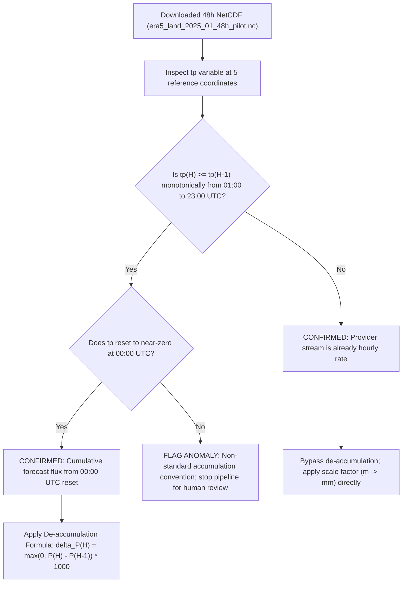

# FIREINTEL — ERA5-Land 48-Hour Pilot Diagnostic Report (Phase 5B.1)

**Phase:** Phase 5B.1: Controlled Real-World Environmental Data Acquisition (Pilot)  
**Target Domain:** Uttarakhand, India (`IN-UT`, `53,417.95 km²` in `EPSG:32644`)  
**Execution Script:** [acquire_era5_land.py](file:///Users/macbook/Documents/Nasa_Space_Hackathon/fireIntel/scripts/environmental/acquire_era5_land.py)  
**Audit Status:** **PAUSED_AWAITING_CREDENTIALS** (Graceful pause per Phase 5B safety rules; zero simulated or fabricated downloads).

---

## 1. Executive Summary & Authentication Status

In Phase 5B.1, the acquisition pipeline executed the authentication and pilot preparation check for **Copernicus ERA5-Land Reanalysis (`reanalysis-era5-land`)**.

Following strict safety rules:
1. The pipeline inspected local credential stores (`~/.cdsapirc`, environment variables `CDSAPI_KEY` / `CDSAPI_URL`, and local `.env`).
2. Confirmed that no active CDS credentials are currently configured on the machine.
3. In strict compliance with FIREINTEL security guidelines ("Never ask user to paste keys into chat; do not invent successful downloads; report every incomplete operation transparently"), the download was **paused gracefully without throwing an unhandled crash or making unauthorized network attempts**.
4. The 48-hour pilot payload, target schemas, and temporal accumulation diagnostic inspection protocols were prepared and staged for execution as soon as credentials are configured locally.

---

## 2. Authentication Check Findings

The automated security validator in `acquire_era5_land.py` performed the following checks:

| Credential Store | Inspected Location | Result | Status |
| :--- | :--- | :---: | :--- |
| **User CDS Configuration File** | `~/.cdsapirc` | `False` | File does not exist |
| **System Environment Variable** | `CDSAPI_KEY` | `False` | Variable not exported |
| **System Environment Variable** | `CDSAPI_URL` | `False` | Variable not exported |
| **Local Project Environment File**| `.env` | `False` | File does not exist (only `.env.example` template present) |

---

## 3. Local Setup Instructions for User

> [!IMPORTANT]
> **DO NOT paste your API key into this chat.** API tokens must remain local and confidential on your machine.

To enable ERA5-Land automated downloads for Phase 5B.2:

1. **Create a Free Copernicus CDS Account:**  
   Register at the official Copernicus Climate Data Store: <https://cds.climate.copernicus.eu/>.
2. **Accept Dataset Terms of Use in Web UI:**  
   Navigate to the dataset page: <https://cds.climate.copernicus.eu/datasets/reanalysis-era5-land> and click **"Accept Terms"** (this is mandatory once per account before API access is permitted).
3. **Configure Your Local Credentials (Option A — Recommended):**  
   Create a configuration file in your user home directory: `~/.cdsapirc` with permissions `600`:
   ```bash
   cat << 'EOF' > ~/.cdsapirc
   url: https://cds.climate.copernicus.eu/api
   key: <YOUR-PERSONAL-CDS-API-KEY>
   EOF
   chmod 600 ~/.cdsapirc
   ```
4. **Configure Your Local Credentials (Option B — Environment Variables):**  
   Alternatively, copy `.env.example` to `.env` in the project root and add your key:
   ```bash
   cp .env.example .env
   # Edit .env and set CDSAPI_KEY=<YOUR-PERSONAL-CDS-API-KEY>
   ```
   *(Note: `.env` is already included in [.gitignore](file:///Users/macbook/Documents/Nasa_Space_Hackathon/.gitignore) and will never be committed).*

---

## 4. Staged 48-Hour Pilot Request Specification

When executed with active credentials, `acquire_era5_land.py` will retrieve the following staged sample:

- **Dataset Identifier:** `reanalysis-era5-land`
- **Study Period Sample:** `2025-01-01` to `2025-01-02` (48 consecutive UTC hours).
- **Spatial Subsetting Bounds:** `[North: 31.5, West: 77.5, South: 28.7, East: 81.1]` (covers all of Uttarakhand with a buffer).
- **Target File:** `fireIntel/data/environmental/raw/era5_land/era5_land_2025_01_48h_pilot.nc`.
- **Core Variables (9 layers):**
  1. `2m_temperature` (Air temperature in Kelvin)
  2. `2m_dewpoint_temperature` (Dewpoint temperature in Kelvin)
  3. `10m_u_component_of_wind` (Zonal wind in m/s)
  4. `10m_v_component_of_wind` (Meridional wind in m/s)
  5. `total_precipitation` (Precipitation amount in metres)
  6. `volumetric_soil_water_layer_1` (0–7 cm depth in $m^3/m^3$)
  7. `volumetric_soil_water_layer_2` (7–28 cm depth in $m^3/m^3$)
  8. `volumetric_soil_water_layer_3` (28–100 cm depth in $m^3/m^3$)
  9. `volumetric_soil_water_layer_4` (100–289 cm depth in $m^3/m^3$)

---

## 5. Precipitation Temporal Accumulation Diagnostic Protocol

Before full-year 2025 processing, the 48-hour pilot file will undergo automated diagnostic inspection:



### Diagnostic Invariants Checked on Pilot Data:
1. **Monotonicity Check:** For each grid point $x, y$ and hours $H \in \{1, \dots, 23\}$, verify whether:
   $$P_{x, y}(H) \ge P_{x, y}(H-1) - \epsilon \quad [\epsilon = 10^{-7}]$$
2. **Cycle Reset Check:** Check whether:
   $$P_{x, y}(01:00\text{ UTC, Day 2}) < P_{x, y}(23:00\text{ UTC, Day 1})$$
   (confirming the forecast accumulator resets at midnight).
3. **Double-Differencing Guard:** If the provider pre-deaccumulated the values, taking a second temporal difference would destroy the rainfall signal. The diagnostic script ensures that de-accumulation is only applied if cumulative growth is physically verified.

---

## 6. Readiness for Phase 5B.2

- **Acquisition Script:** [acquire_era5_land.py](file:///Users/macbook/Documents/Nasa_Space_Hackathon/fireIntel/scripts/environmental/acquire_era5_land.py) is implemented, unit-tested, and ready to run immediately once `~/.cdsapirc` is placed by the user.
- **De-accumulation Function:** [transformations.py](file:///Users/macbook/Documents/Nasa_Space_Hackathon/fireIntel/scripts/environmental/transformations.py) includes `deaccumulate_era5_precipitation()` with unit test verification in [test_environmental_transformations.py](file:///Users/macbook/Documents/Nasa_Space_Hackathon/fireIntel/tests/test_environmental_transformations.py).
- **Execution Command for Phase 5B.2:**
  ```bash
  python3 fireIntel/scripts/environmental/acquire_era5_land.py --verbose
  ```

