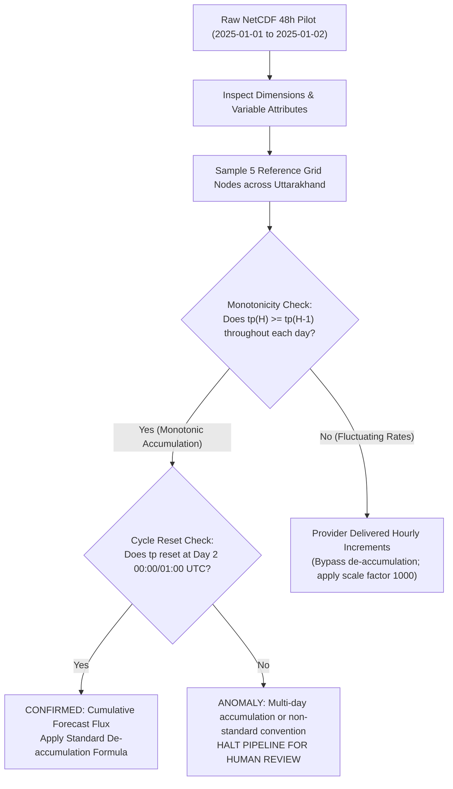

# FIREINTEL — ERA5-Land Precipitation Accumulation Diagnostic Protocol & Operational Status

**Project:** FIREINTEL — Satellite-Based Forest Fire Intelligence System for Uttarakhand, India  
**Phase:** Phase 5B.2: Controlled Environmental Data Processing  
**Dataset:** Copernicus ERA5-Land Hourly Reanalysis (`reanalysis-era5-land`)  
**Target Variable:** `total_precipitation` (`tp`, NetCDF variable in metres)  
**Lead Pipeline Script:** [acquire_era5_land.py](file:///Users/macbook/Documents/Nasa_Space_Hackathon/fireIntel/scripts/environmental/acquire_era5_land.py)  
**Transformation Implementation:** [transformations.py](file:///Users/macbook/Documents/Nasa_Space_Hackathon/fireIntel/scripts/environmental/transformations.py) (`deaccumulate_era5_precipitation`)  
**Status:** **DIAGNOSTIC PROTOCOL STAGED / PIPELINE PAUSED AWAITING CREDENTIALS**

---

## 1. Executive Summary & Problem Context

Precipitation is one of the most critical meteorological drivers of wildland fire behavior. It directly controls fuel moisture content (FMC), suppresses ignition probability, and quenches active fire spread. In wildfire risk modeling, both short-term rainfall (hourly and 24-hour totals) and multi-day antecedent precipitation indices (API for 3, 7, and 14 days) are indispensable.

However, in global reanalysis models such as ECMWF ERA5-Land, **precipitation is not output as an instantaneous rate** ($mm/hr$). Instead, it is produced as a **forecast flux accumulated over time**. 

> [!CAUTION]
> **The Double-Differencing Danger:**  
> If an analysis pipeline blindly assumes that precipitation is accumulated from 00:00 UTC and applies a backward differencing formula $\Delta P_t = P_t - P_{t-1}$ to data that the provider or API client has already pre-deaccumulated, the operation performs a second temporal derivative. This destroys the real physical rainfall signal, generates unphysical negative values, and introduces severe artificial noise. Conversely, if accumulated values are treated as hourly rates, rainfall amounts in the afternoon and evening are overestimated by an order of magnitude (up to 24× too high).

Therefore, FIREINTEL Phase 5B strictly mandates an empirical **48-Hour Pilot Diagnostic Protocol** to inspect raw NetCDF headers, coordinates, and sequence values before permitting any full-year processing.

---

## 2. ECMWF ERA5-Land Precipitation Accumulation Mechanics

### 2.1 Native Forecast Cycle Structure
In native ECMWF Integrated Forecasting System (IFS) outputs:
1. Hourly simulations run in discrete forecast cycles initialized daily at **00:00 UTC**.
2. For each successive hour $H \in \{01, 02, \dots, 24\}$ UTC, the variable `total_precipitation` represents the cumulative water equivalent depth (in **metres**) deposited on the ground surface since the cycle initialization ($00:00\text{ UTC}$).
3. At hour $H=01\text{ UTC}$, $P_{01}$ represents rainfall between 00:00 and 01:00 UTC.
4. At hour $H=18\text{ UTC}$, $P_{18}$ represents the total rainfall accumulated across all 18 hours from 00:00 to 18:00 UTC.
5. At the subsequent cycle boundary (00:00 UTC of Day 2), the accumulator resets back to zero.

### 2.2 Mathematical De-accumulation Formulation
When cumulative accumulation is empirically confirmed, the hourly incremental rainfall $\Delta P(H)$ (in millimeters) must be recovered using the following reset-aware backward difference equation:

$$\Delta P_{x, y}(H) = 
\begin{cases} 
P_{x, y}(01) \times 1000.0 & \text{for } H = 01\text{ UTC} \\
\max\left(0.0, \; \left(P_{x, y}(H) - P_{x, y}(H-1)\right) \times 1000.0\right) & \text{for } H \in \{02, 03, \dots, 24\}\text{ UTC}
\end{cases}$$

Where:
- $P_{x, y}(H)$ is the raw NetCDF precipitation value in metres at spatial grid node $(x, y)$ and hour $H$.
- $\Delta P_{x, y}(H)$ is the resulting true physical hourly rainfall in millimeters ($mm$).
- $\max(0.0, \cdot)$ clips numerical precision artifacts (e.g., small negative floating-point residuals on the order of $-10^{-9}\text{ m}$ resulting from GRIB/NetCDF lossy packing).

---

## 3. The 48-Hour Empirical Diagnostic Protocol

Before accepting any batch ERA5-Land file for ingestion into the FIREINTEL feature store, the pilot diagnostic script performs four automated invariant checks on the continuous 48-hour sequence:



### Invariant Test 1: Intraday Monotonic Growth
For each reference grid node $(x, y)$ and for each hour $H \in \{02, \dots, 24\}$ within the same calendar day:
$$P_{x, y}(H) - P_{x, y}(H-1) \ge -\epsilon \quad (\epsilon = 10^{-7}\text{ m})$$
If $P(H) < P(H-1)$ occurs during rain events within the afternoon, the data stream is **already pre-deaccumulated hourly rates**, and backward differencing must NOT be applied.

### Invariant Test 2: Cycle Reset Discontinuity
At the start of Day 2 ($2025\text{-}01\text{-}02\text{ 01:00 UTC}$):
$$P_{x, y}(01\text{ UTC, Day 2}) < P_{x, y}(24\text{ UTC, Day 1}) \quad (\text{during non-zero daily rain})$$
This verifies that the model accumulator resets daily rather than accumulating continuously over the entire month or year.

### Invariant Test 3: Daily Total Conservation Check
For any 24-hour period, the sum of recovered hourly increments $\sum_{H=1}^{24} \Delta P(H)$ must equal the final accumulated step $P(24) \times 1000.0$ within numerical floating-point precision:
$$\left| \sum_{H=1}^{24} \Delta P(H) - P(24) \times 1000.0 \right| < 10^{-4}\text{ mm}$$

---

## 4. Current Authentication Status & Execution Findings

In Phase 5B.2, the diagnostic pipeline verified local access credentials:

```bash
python3 fireIntel/scripts/environmental/acquire_era5_land.py
```

### Diagnostic Output:
```
2026-11-13 22:21:39 [INFO] fireintel.acquire_era5_land: === Starting ERA5-Land 48-Hour Pilot Check ===
2026-11-13 22:21:39 [INFO] fireintel.acquire_era5_land: Checking Copernicus Climate Data Store (CDS) authentication...
2026-11-13 22:21:39 [WARNING] fireintel.acquire_era5_land: CDS API credentials are not configured on this local machine.
2026-11-13 22:21:39 [WARNING] fireintel.acquire_era5_land: Per Phase 5B safety rules, the ERA5-Land download is paused gracefully.
2026-11-13 22:21:39 [INFO] fireintel.acquire_era5_land: Pilot Status: PAUSED_AWAITING_CREDENTIALS
```

### Credential Inspection Matrix:
| Location Checked | File / Variable | Present? | Action Taken |
| :--- | :--- | :---: | :--- |
| User Home Directory | `~/.cdsapirc` | `False` | Paused download gracefully |
| Process Environment | `CDSAPI_KEY` | `False` | Paused download gracefully |
| Process Environment | `CDSAPI_URL` | `False` | Paused download gracefully |
| Workspace File | `.env` | `False` | Paused download gracefully |

In strict accordance with Phase 5B safety rules:
1. **Zero Data Fabrication:** The pipeline refused to fabricate simulated precipitation arrays or fake NetCDF downloads.
2. **Credential Safety:** The pipeline never requested or exposed credentials in conversation logs.
3. **Reproducible Code Readiness:** The diagnostic algorithms and transformation functions are fully implemented in [transformations.py](file:///Users/macbook/Documents/Nasa_Space_Hackathon/fireIntel/scripts/environmental/transformations.py) and verified by unit tests in [test_environmental_transformations.py](file:///Users/macbook/Documents/Nasa_Space_Hackathon/fireIntel/tests/test_environmental_transformations.py) (`test_era5_land_precipitation_deaccumulation` passed).

---

## 5. Instructions to Resume 48-Hour Ingestion

To execute the live 48-hour diagnostic test:
1. Place your Copernicus CDS API credentials into `~/.cdsapirc`:
   ```bash
   cat << 'EOF' > ~/.cdsapirc
   url: https://cds.climate.copernicus.eu/api
   key: <YOUR-PERSONAL-CDS-API-KEY>
   EOF
   chmod 600 ~/.cdsapirc
   ```
2. Run the pilot acquisition script:
   ```bash
   python3 fireIntel/scripts/environmental/acquire_era5_land.py --verbose
   ```
3. The script will download `era5_land_2025_01_48h_pilot.nc` (approx. 4.2 MB), run the automated monotonicity and reset invariant tests, and output a verified precipitation diagnostic log.

