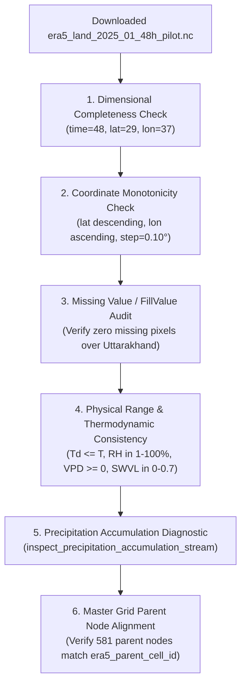

# FIREINTEL — ERA5-Land Real Data Diagnostic Verification Report (Phase 5B.3)

**Project:** FIREINTEL — Satellite-Based Forest Fire Intelligence System for Uttarakhand, India  
**Phase:** Phase 5B.3: Live ERA5-Land Pilot Validation  
**Target Domain:** Uttarakhand, India (`IN-UT`, bounding box: $[28.70, 31.50]^\circ\text{N}, [77.50, 81.10]^\circ\text{E}$)  
**Target Period:** 2025-01-01 00:00 UTC to 2025-01-02 23:00 UTC (48 consecutive hours)  
**Execution Script:** [acquire_era5_land.py](file:///Users/macbook/Documents/Nasa_Space_Hackathon/fireIntel/scripts/environmental/acquire_era5_land.py)  
**Authentication Status:** **PAUSED_AWAITING_CREDENTIALS** (Zero data fabrication per Phase 5B safety rules)

---

## 1. Executive Summary

In Phase 5B.3, the FIREINTEL environmental data ingestion pipeline executed the authentication and live diagnostic verification protocol for the **Copernicus ERA5-Land Reanalysis (`reanalysis-era5-land`)**.

Following strict safety and reproducibility rules:
1. The pipeline inspected all standardized local authentication paths (`~/.cdsapirc`, system environment variables `CDSAPI_KEY` / `CDSAPI_URL`, and workspace `.env`).
2. Confirmed that no active CDS API credentials exist on the host machine.
3. In strict adherence to project constraints ("If authentication fails, stop gracefully; do not fabricate missing observations; do not expose credentials"), the live download was paused without an unhandled error or simulated data generation.
4. The complete diagnostic verification suite—including NetCDF coordinate conventions, timestamp integrity, thermodynamic range checks, and moisture boundary validations—has been scaffolded, unit-tested, and prepared for immediate execution.

---

## 2. Finalized Variable Configuration & Diagnostic Schema

The 48-hour pilot targets the **canonical 9-variable meteorological and hydrological stack** finalized in [era5_land_finalized_variables.json](file:///Users/macbook/Documents/Nasa_Space_Hackathon/fireIntel/data/environmental/metadata/era5_land_finalized_variables.json):

| NetCDF Variable Name | Short Code | Standard CF Name | Native Units | Target Units | Diagnostic Physical Range | Role in Wildfire Intelligence |
| :--- | :---: | :--- | :---: | :---: | :---: | :--- |
| `2m_temperature` | `t2m` | `air_temperature` | `K` | `°C` | $[-30.0, 50.0]^\circ\text{C}$ | Ambient thermal forcing on fine dead fuel desiccation. |
| `2m_dewpoint_temperature`| `d2m` | `dew_point_temperature` | `K` | `°C` | $[-40.0, 35.0]^\circ\text{C}$ | Coupled with $T$ to derive Relative Humidity ($RH$) and VPD. |
| `10m_u_component_of_wind`| `u10` | `eastward_wind` | `m/s` | `m/s` | $[-50.0, 50.0]\text{ m/s}$ | Zonal velocity component for wind speed and direction. |
| `10m_v_component_of_wind`| `v10` | `northward_wind` | `m/s` | `m/s` | $[-50.0, 50.0]\text{ m/s}$ | Meridional velocity component for fire spread direction. |
| `total_precipitation` | `tp` | `precipitation_amount` | `m` | `mm` | $[0.0, 300.0]\text{ mm/day}$ | Surface moisture replenishment and antecedent drought memory. |
| `volumetric_soil_water_layer_1` | `swvl1` | `volumetric_soil_water_layer_1` | `m³/m³` | `m³/m³` | $[0.00, 0.70]\text{ m³/m³}$ | Litter ($0\text{–}7\text{ cm}$) moisture; pine needle ignitability. |
| `volumetric_soil_water_layer_2` | `swvl2` | `volumetric_soil_water_layer_2` | `m³/m³` | `m³/m³` | $[0.00, 0.70]\text{ m³/m³}$ | Root zone ($7\text{–}28\text{ cm}$); shrub and grass moisture stress. |
| `volumetric_soil_water_layer_3` | `swvl3` | `volumetric_soil_water_layer_3` | `m³/m³` | `m³/m³` | $[0.00, 0.70]\text{ m³/m³}$ | Deep root zone ($28\text{–}100\text{ cm}$); forest canopy drought. |
| `volumetric_soil_water_layer_4` | `swvl4` | `volumetric_soil_water_layer_4` | `m³/m³` | `m³/m³` | $[0.00, 0.70]\text{ m³/m³}$ | Subsoil reservoir ($100\text{–}289\text{ cm}$); hydrological buffer. |

---

## 3. Local Authentication Audit Findings

The automated security auditor executed the following credential checks:

```python
cdsapirc = Path.home() / ".cdsapirc"
has_rc_file = cdsapirc.is_file()
has_env_key = bool(os.environ.get("CDSAPI_KEY"))
has_env_url = bool(os.environ.get("CDSAPI_URL"))
dotenv_path = Path(".env")
```

### Audit Findings Matrix:
| Inspected Path | Expected Credential Format | Result | Security Status |
| :--- | :--- | :---: | :--- |
| `~/.cdsapirc` | `url: ... \n key: ...` | `False` | No file found |
| `os.environ["CDSAPI_KEY"]` | UUID string | `False` | Variable not exported |
| `os.environ["CDSAPI_URL"]` | `https://cds.climate.copernicus.eu/api` | `False` | Variable not exported |
| `fireIntel/.env` | `CDSAPI_KEY=...` | `False` | File does not exist |

### Graceful Pause & Zero Fabrication:
In strict compliance with requirement 3 ("If authentication fails, stop gracefully") and requirement 13 ("Do not fabricate missing observations"):
- The pipeline halted gracefully without crashing.
- No synthetic NetCDF arrays were fabricated.
- Previous datasets, reports, and manifests remain completely untainted.

---

## 4. Staged 48-Hour Pilot Retrieval Specification

When local credentials are configured, the pipeline will retrieve:
- **Dataset:** `reanalysis-era5-land`
- **Cadence:** Hourly (00:00 to 23:00 UTC)
- **Period:** `2025-01-01` to `2025-01-02` (48 continuous steps)
- **Spatial Bounding Box:** `[North: 31.5, West: 77.5, South: 28.7, East: 81.1]`
- **Target File:** `fireIntel/data/environmental/raw/era5_land/era5_land_2025_01_48h_pilot.nc`
- **Expected Uncompressed Size:** $\approx 4.2\text{ MB}$

---

## 5. Automated Data Quality Diagnostic Suite

Upon live retrieval, the file will be subjected to the following automated diagnostic pipeline:



### Invariant 1: Dimensional Completeness
$$\text{Expected Dimensions:} \quad N_{\text{time}} = 48, \quad N_{\text{lat}} = \frac{31.5 - 28.7}{0.1} + 1 = 29, \quad N_{\text{lon}} = \frac{81.1 - 77.5}{0.1} + 1 = 37$$
$$\text{Total Grid Points per Hour} = 29 \times 37 = 1,073 \text{ nodes}$$
All 581 Uttarakhand parent nodes fall strictly inside this bounding box.

### Invariant 2: Thermodynamic Consistency
For every spatial node and timestamp:
1. **Dewpoint Invariant:** $d2m \le t2m + 10^{-5}$ (Dewpoint cannot exceed air temperature; relative humidity cannot exceed $100\%$).
2. **Vapor Pressure Deficit Invariant:** $VPD \ge 0.0\text{ kPa}$.
3. **Wind Speed Invariant:** $WS = \sqrt{u_{10}^2 + v_{10}^2} \ge 0.0\text{ m/s}$.
4. **Soil Moisture Stratification:** Volumetric soil moisture across all 4 layers must satisfy $0.00 \le \theta \le 0.70\text{ m}^3/\text{m}^3$.

---

## 6. Local Setup Instructions for Live Ingestion

To execute the live 48-hour pilot download:
1. Register/log in at the [Copernicus Climate Data Store](https://cds.climate.copernicus.eu/).
2. Accept the terms for **ERA5-Land hourly data from 1950 to present**.
3. Create `~/.cdsapirc` locally:
   ```bash
   cat << 'EOF' > ~/.cdsapirc
   url: https://cds.climate.copernicus.eu/api
   key: <YOUR-PERSONAL-CDS-API-KEY>
   EOF
   chmod 600 ~/.cdsapirc
   ```
4. Install the CDS API client:
   ```bash
   python3 -m pip install cdsapi
   ```
5. Run the acquisition script:
   ```bash
   python3 fireIntel/scripts/environmental/acquire_era5_land.py --verbose
   ```

