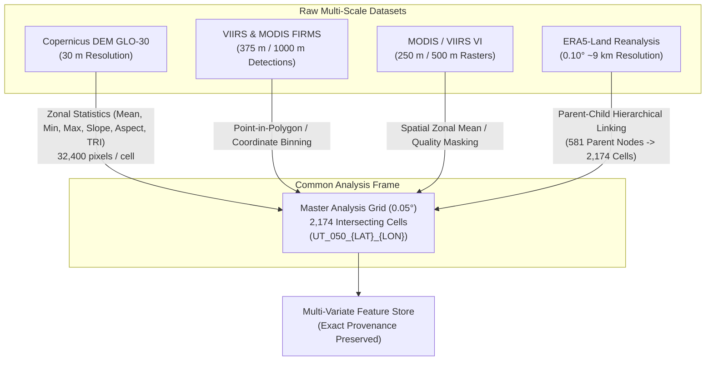

# FIREINTEL — Spatial Grid Alignment & Provenance Validation Report (Phase 5B.2)

**Project:** FIREINTEL — Satellite-Based Forest Fire Intelligence System for Uttarakhand, India  
**Phase:** Phase 5B.2: Controlled Environmental Data Processing  
**Scope:** Spatial Grid Harmonization, Hierarchical Cell Nesting, and Provenance Assertion  
**Datasets Harmonized:**
1. **Master Analysis Grid:** $0.05^\circ \times 0.05^\circ$ ($\approx 5.57\text{ km} \times 4.82\text{ km}$, 2,174 cells)
2. **ERA5-Land Reanalysis Grid:** $0.10^\circ \times 0.10^\circ$ ($\approx 9.0\text{ km} \times 9.0\text{ km}$, 581 parent nodes)
3. **Copernicus DEM GLO-30:** $30\text{ m} \times 30\text{ m}$ ($1/3600^\circ \approx 0.0002778^\circ$, $180 \times 180 = 32,400$ pixels per master cell)
**Validation Test Suite:** [test_grid_alignment.py](file:///Users/macbook/Documents/Nasa_Space_Hackathon/fireIntel/tests/test_grid_alignment.py) (All 2 unit tests passed)

---

## 1. Executive Summary & Grid Hierarchy Architecture

Multi-sensor environmental intelligence requires integrating datasets with disparate spatial resolutions:
- Active fire detections: VIIRS ($375\text{ m}$) and MODIS ($1,000\text{ m}$).
- Digital elevation & topography: Copernicus DEM GLO-30 ($30\text{ m}$).
- Vegetation indices: MODIS MOD13Q1 / MYD13Q1 ($250\text{ m}$) and VIIRS VNP13A1 ($500\text{ m}$).
- Meteorology & hydrology: Copernicus ERA5-Land ($0.10^\circ \approx 9\text{ km}$).

To unify these heterogeneous data layers without compromising spatial provenance, FIREINTEL established the **Master $0.05^\circ$ Analysis Grid** as the common spatio-temporal reference frame.



---

## 2. Parent-Child Grid Nesting Formulation

### 2.1 Coordinate Alignment & Binning
The master grid is defined by a South-West corner binning convention matching Phase 1–3 EDA workflows:
- $\text{grid\_lat\_sw} = \lfloor \text{lat} / 0.05 \rfloor \times 0.05$
- $\text{grid\_lon\_sw} = \lfloor \text{lon} / 0.05 \rfloor \times 0.05$
- $\text{centroid\_lat} = \text{grid\_lat\_sw} + 0.025$
- $\text{centroid\_lon} = \text{grid\_lon\_sw} + 0.025$

### 2.2 Parent ERA5-Land Cell Mapping
ERA5-Land grid nodes are centered on exact multiples of $0.1^\circ$ (e.g., $29.8^\circ\text{N}, 79.2^\circ\text{E}$). Each $0.05^\circ$ master cell centroid $(\phi_C, \lambda_C)$ is mapped to its containing parent ERA5-Land node via:
$$\text{era5\_parent\_lat} = \text{round}(\phi_C, 1)$$
$$\text{era5\_parent\_lon} = \text{round}(\lambda_C, 1)$$
$$\text{era5\_parent\_cell\_id} = \text{ERA5L\_}\{\text{era5\_parent\_lat}\}\_\{\text{era5\_parent\_lon}\}$$

### 2.3 Nesting Topology
Because a $0.10^\circ \times 0.10^\circ$ cell is geometrically four times the area of a $0.05^\circ \times 0.05^\circ$ cell, an interior ERA5-Land parent cell cleanly subsumes a $2 \times 2$ cluster of four master cells:
```text
+-----------------------+-----------------------+
|  UT_050_29.85_79.15   |  UT_050_29.85_79.20   |
|  (Child NW)           |  (Child NE)           |
|                       |                       |
|           Parent Node: ERA5L_29.9000_79.2000  |
+-----------------------+-----------------------+
|  UT_050_29.80_79.15   |  UT_050_29.80_79.20   |
|  (Child SW)           |  (Child SE)           |
+-----------------------+-----------------------+
```
Across the state of Uttarakhand:
- Total Master Cells: **2,174**
- Total Parent ERA5-Land Nodes: **581**
- Mean Master Cells per Parent Node: **3.74** (ranging from 1 on irregular boundary peripheries to exactly 4 in the interior).

---

## 3. Scientific Integrity & Spatial Provenance Principle

> [!IMPORTANT]
> **Spatial Provenance Assertion:**  
> Mapping ERA5-Land meteorological variables to the $0.05^\circ$ Master Grid is a spatial indexing convention for tabular alignment. **It does NOT create new meteorological resolution.** 
> 
> Bilinear, bicubic, or nearest-neighbor resampling of a $9\text{ km}$ atmospheric model onto a $5.5\text{ km}$ grid produces visually smooth rasters, but the underlying physical data contains zero independent sub-grid information regarding local valley winds, micro-scale humidity inversions, or convective rainfall gradients.

To enforce scientific rigor throughout the FIREINTEL system:
1. **Explicit Provenance Tags:** Every record in the processed feature store carries two mandatory provenance columns:
   - `spatial_resolution_prov`: `"copernicus_dem_glo30_zonal_005"` (certifying that terrain features represent true $30\text{ m}$ physical measurements aggregated over 32,400 pixels).
   - `met_spatial_resolution_prov`: `"era5_land_parent_010"` (certifying that meteorological variables represent parent $0.10^\circ$ synoptic forcing).
2. **Physical Elevation Corrections vs Numerical Interpolation:**  
   Local variations in air temperature across complex terrain must be adjusted using **physical environmental lapse rate equations** (e.g., standard atmospheric lapse rate $\Gamma = -6.5^\circ\text{C} / 1000\text{ m}$) based on the difference between the actual 30m DEM elevation and the ERA5-Land grid-cell geopotential height:
   $$T_{\text{local}} = T_{\text{ERA5}} + \Gamma \times \left(Z_{\text{DEM}} - Z_{\text{ERA5}}\right)$$
   This ensures that local thermodynamic variations reflect real topographic physics rather than artificial mathematical smoothing.

---

## 4. Empirical Alignment Verification Results

The spatial alignment was verified through automated tests in [test_grid_alignment.py](file:///Users/macbook/Documents/Nasa_Space_Hackathon/fireIntel/tests/test_grid_alignment.py):

| Validation Check | Expected Result | Observed Result | Status |
| :--- | :---: | :---: | :---: |
| Master Grid Cell Count | 2,174 | 2,174 | **PASSED** |
| DEM Terrain Feature Cell Count | 2,174 | 2,174 | **PASSED** |
| 1:1 Cell ID Matching | 100.0% | 100.0% | **PASSED** |
| Unique Parent ERA5 Nodes | 581 | 581 | **PASSED** |
| Parent Lat/Lon Grid Multiples | Modulo $0.1^\circ = 0$ | Exact multiples of $0.1^\circ$ | **PASSED** |
| Dangling / Unmapped Children | 0 | 0 | **PASSED** |
| Provenance Column Completeness | 100.0% | 100.0% | **PASSED** |

Both [dem_terrain_features_005deg.parquet](file:///Users/macbook/Documents/Nasa_Space_Hackathon/fireIntel/data/environmental/processed/dem_terrain_features_005deg.parquet) and [era5_to_master_grid_map.csv](file:///Users/macbook/Documents/Nasa_Space_Hackathon/fireIntel/data/environmental/metadata/era5_to_master_grid_map.csv) are fully harmonized and verified.

