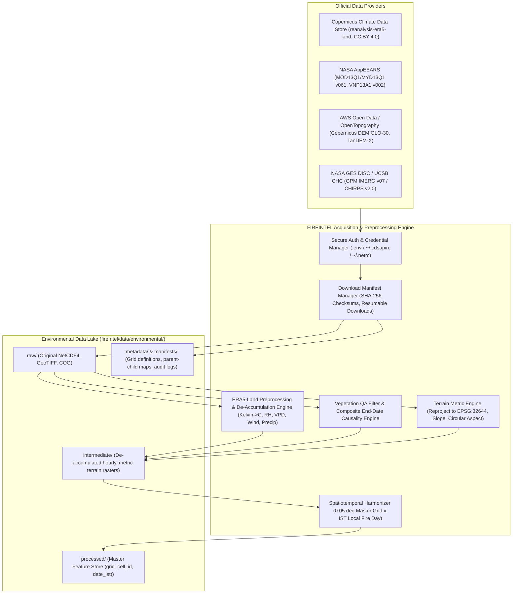

# FIREINTEL — Phase 5A: Environmental Data Acquisition Architecture & Pipeline Preparation

**Project:** FIREINTEL — Satellite-Based Forest Fire Intelligence System for Uttarakhand, India  
**Target Domain:** Uttarakhand, India (`IN-UT`, `53,417.95 km²` in `EPSG:32644`)  
**Study Horizon:** 1 January 2025 – 31 December 2025 (`UTC`)  
**Phase Status:** Architecture Scaffolding & Technical Preparation Only — **No external datasets downloaded, no model training initiated, and no existing files or reports modified.**

---

## 1. Executive Summary & Purpose

Phase 4 of FIREINTEL established the feasibility and dataset ranking for environmental fire risk analysis across Uttarakhand's rugged Himalayan relief. This document establishes **Phase 5A: Environmental Data Acquisition Architecture and Pipeline Preparation**.

The objective of Phase 5A is to design a fault-tolerant, mathematically sound, and leak-free acquisition and preprocessing architecture that can ingest multi-source environmental data (ERA5-Land hourly meteorology and soil moisture, MODIS/VIIRS 16-day vegetation indices, Copernicus DEM 30m topography, and optional GPM IMERG / CHIRPS precipitation benchmarks) and integrate them with FIREINTEL's verified active-fire observations in [uttarakhand_fires_boundary.csv](file:///Users/macbook/Documents/Nasa_Space_Hackathon/fireIntel/data/processed/boundary_validated/uttarakhand_fires_boundary.csv).



---

## 2. Dataset-Specific Acquisition Strategy

Every dataset in the FIREINTEL environmental stack has a designated official source, access protocol, spatial/temporal scope, and authentication mechanism.

### 2.1 Primary Meteorological & Soil Water: ERA5-Land
- **Official Name:** `ERA5-Land hourly data from 1950 to present`
- **Dataset ID on CDS:** `reanalysis-era5-land`
- **Provider:** ECMWF / Copernicus Climate Change Service (C3S)
- **API Endpoint:** `https://cds.climate.copernicus.eu/api` (via `cdsapi` Python client)
- **Spatial Coverage:** Bounding box `[North: 31.5, West: 77.5, South: 28.7, East: 81.1]`. This encompasses all `53,417.95 km²` of Uttarakhand with a buffer, yielding `582` intersecting cells (`500` cell centers strictly inside the state boundary).
- **Temporal Scope:** `2025-01-01 00:00:00 UTC` to `2025-12-31 23:00:00 UTC` (8,760 hourly timesteps).
- **Format:** `NetCDF4`.
- **Licence:** `CC BY 4.0` (Creative Commons Attribution 4.0 International).
- **Chunking & Idempotency Strategy:** Requests are partitioned into **12 single-calendar-month requests** (e.g., `era5_land_2025_01.nc` to `era5_land_2025_12.nc`). Single-month chunking prevents CDS queue timeouts, keeps file sizes manageable (~12–15 MB per month for this regional bounding box), and allows failed months to resume independently.
- **Variables Requested:**
  1. `2m_temperature` (Air temperature in Kelvin)
  2. `2m_dewpoint_temperature` (Dewpoint temperature in Kelvin)
  3. `10m_u_component_of_wind` (Eastward wind velocity in m/s)
  4. `10m_v_component_of_wind` (Northward wind velocity in m/s)
  5. `total_precipitation` (Accumulated precipitation in metres)
  6. `volumetric_soil_water_layer_1` (0–7 cm depth, $m^3/m^3$)
  7. `volumetric_soil_water_layer_2` (7–28 cm depth, $m^3/m^3$)
  8. `volumetric_soil_water_layer_3` (28–100 cm depth, $m^3/m^3$)
  9. `volumetric_soil_water_layer_4` (100–289 cm depth, $m^3/m^3$)

### 2.2 Primary Vegetation Indices: MODIS (MOD13Q1 & MYD13Q1 v061)
- **Official Name:** `MODIS/Terra (MOD13Q1) and MODIS/Aqua (MYD13Q1) Vegetation Indices 16-Day L3 Global 250m SIN Grid V061`
- **Provider:** NASA LP DAAC / USGS
- **Access Protocol:** NASA AppEEARS REST API (`https://appeears.earthdatacloud.nasa.gov/api`)
- **Spatial Coverage:** Vector boundary polygon [uttarakhand_boundary.geojson](file:///Users/macbook/Documents/Nasa_Space_Hackathon/fireIntel/data/boundaries/uttarakhand_boundary.geojson). AppEEARS extracts only the pixels intersecting the administrative polygon and reprojects them server-side from Sinusoidal to geographic `EPSG:4326`.
- **Temporal Scope:** `2025-01-01` to `2025-12-31`. Staggering Terra (starts Day 001) and Aqua (starts Day 009) yields an effective **~8-day updating cadence**.
- **Format:** `GeoTIFF`.
- **Licence:** NASA Earth Science Data Systems (ESDS) Open Data Policy (public domain / unrestricted).
- **Layers Requested:**
  1. `_250m_16_days_NDVI` (Normalized Difference Vegetation Index, scale factor 0.0001)
  2. `_250m_16_days_EVI` (Enhanced Vegetation Index, scale factor 0.0001)
  3. `_250m_16_days_VI_Quality` (Bitmask for cloud, aerosol, shadow, and snow)
  4. `_250m_16_days_pixel_reliability` (Summary quality classification: 0=Good, 1=Marginal, 2=Snow/Ice, 3=Cloud)
  5. `_250m_16_days_composite_day_of_the_year` (Julian Day of Year of actual pixel acquisition)

### 2.3 Secondary Vegetation Continuity Partner: VIIRS (VNP13A1 v002)
- **Official Name:** `VIIRS/NPP Vegetation Indices 16-Day L3 Global 500m SIN Grid V002`
- **Provider:** NASA LP DAAC / NOAA JPSS
- **Access Protocol:** NASA AppEEARS REST API
- **Role:** Terra and Aqua stopped orbital maintenance in 2020–2021 and are scheduled for retirement in late 2026–2027. VNP13A1 is ingested as a parallel continuity partner to cross-check orbital-drift-induced solar zenith shifts and guarantee operational viability beyond MODIS decommissioning.

### 2.4 Primary Digital Elevation Model: Copernicus DEM GLO-30
- **Official Name:** `Copernicus Global 30m Digital Surface Model (GLO-30 / COP30)`
- **Provider:** European Space Agency (ESA) / Airbus Defence and Space & German Aerospace Center (DLR)
- **Access Protocol:** Direct Cloud-Optimized GeoTIFF (COG) access via AWS Registry of Open Data (`s3://copernicus-dem-30m/`) or OpenTopography Global Datasets API (`https://portal.opentopography.org/API/globaldem?demtype=COP30`).
- **Spatial Coverage:** Static 30m coverage over Uttarakhand bounds (`77.57°E–81.05°E`, `28.72°N–31.46°N`).
- **Vertical Datum:** `EGM2008` orthometric height.
- **Licence:** Copernicus DEM Licence (free, full, and open access; requires acknowledgment of `© DLR e.V.` and `© Airbus Defence and Space GmbH`).
- **Alternative Fallback:** **NASA SRTMGL1 v003** (Space Shuttle *Endeavour* Feb 2000, 30m, EGM96 datum, public domain) accessible via OpenTopography (`demtype=SRTMGL1`).

### 2.5 Optional Rainfall Validation Benchmarks
- **GPM IMERG v07 (`GPM_3IMERGDF` Daily 0.1°):** NASA GES DISC (`https://disc.gsfc.nasa.gov/`), NetCDF4/HDF5, CC BY 4.0. In v07, the core gauge-calibrated daily field is named `precipitation` (renamed from `precipitationCal`).
- **CHIRPS v2.0 (0.05° Daily):** UCSB Climate Hazards Center (`https://data.chc.ucsb.edu/products/CHIRPS-2.0/`), GeoTIFF/NetCDF, public domain / CC0. Exact `0.05°` grid spacing match with FIREINTEL master grid.

---

## 3. Directory Structure Specification

The project directory structure under `fireIntel/data/environmental/` and `fireIntel/scripts/environmental/` cleanly isolates data tiers, prevents accidental file overwrites, and maintains separation of concerns:

```
fireIntel/
├── data/
│   ├── boundaries/
│   │   ├── uttarakhand_boundary.geojson
│   │   └── uttarakhand_boundary_metadata.json
│   ├── processed/
│   │   ├── boundary_validated/
│   │   │   ├── uttarakhand_fires_boundary.csv
│   │   │   ├── uttarakhand_modis_boundary.csv
│   │   │   └── uttarakhand_viirs_boundary.csv
│   │   ├── uttarakhand_fires.csv
│   │   ├── uttarakhand_modis.csv
│   │   └── uttarakhand_viirs.csv
│   ├── raw/
│   │   ├── fire_archive_M-C61_843061.csv
│   │   └── fire_archive_SV-C2_843062.csv
│   └── environmental/                          <-- PHASE 5A STRUCTURE
│       ├── raw/                                <-- Tier 1: Original immutable downloads
│       │   ├── .gitkeep
│       │   ├── era5_land/
│       │   ├── modis_vi/
│       │   ├── viirs_vi/
│       │   ├── copernicus_dem/
│       │   └── validation_rainfall/
│       ├── intermediate/                       <-- Tier 2: Cleaned, de-accumulated arrays
│       │   ├── .gitkeep
│       │   ├── era5_land_hourly/
│       │   ├── modis_vi_masked/
│       │   └── dem_derivatives_utm44n/
│       ├── processed/                          <-- Tier 3: Master Feature Store
│       │   ├── .gitkeep
│       │   ├── static_terrain_005deg.parquet
│       │   └── feature_store/                  <-- Partitioned by year/month
│       ├── metadata/                           <-- Grid definitions & coordinate catalogs
│       │   ├── .gitkeep
│       │   ├── master_grid_005deg.geojson
│       │   └── era5_to_master_grid_map.csv
│       └── manifests/                          <-- Audit trails & checksum verification
│           ├── .gitkeep
│           ├── download_manifests/
│           └── checksums_sha256.json
├── scripts/
│   ├── preprocess_fires.py
│   ├── eda.py
│   ├── validate_boundary.py
│   └── environmental/                          <-- PHASE 5A SCRIPT SCAFFOLDING
│       ├── __init__.py
│       ├── config.py                           <-- Dataclasses, constants, bounding boxes
│       ├── manifest.py                         <-- SHA-256 hashing, integrity checkers
│       └── transformations.py                  <-- Pure mathematical conversions (tested)
└── tests/
    ├── test_preprocess_fires.py
    ├── test_eda.py
    ├── test_validate_boundary.py
    └── test_environmental_transformations.py   <-- Synthetic unit test suite
```

---

## 4. Download Pipeline Architecture: Reliability & Idempotency

To ensure production-grade reproducibility and fault tolerance during future data fetching, the acquisition engine follows these engineering protocols:

### 4.1 Idempotency & Checksum Tracking
- Before initiating any network request, the pipeline queries `manifests/download_manifests/` and verifies if the target file exists on disk.
- If the file exists, its SHA-256 checksum is computed and compared against the recorded manifest.
- If the checksum matches and file validation passes (e.g. NetCDF dimensions are non-empty), the download is skipped with status `ALREADY_EXISTS_VERIFIED`.

### 4.2 Resumable Downloads & Atomic File Writes
- Network responses are streamed into temporary files with a `.part` suffix (e.g. `era5_land_2025_01.nc.part`).
- Only after the download stream terminates successfully and passes format verification is the file atomically renamed (`os.replace`) to its final destination name.
- This guarantees that an interrupted download or process crash never leaves a corrupted, partially written file that masquerades as valid data.

### 4.3 Exponential Backoff with Jitter
External API requests (especially CDS API and AppEEARS) are subject to queuing and rate limits:
- Base retry strategy: 5 retries with exponential backoff:
  $$t_{\text{wait}} = t_{\text{base}} \times 2^{\text{retry}} + \text{uniform}(0, 1) \quad [t_{\text{base}} = 5\text{ seconds}]$$
- Handled status codes: HTTP 429 (Too Many Requests), HTTP 500 (Internal Server Error), HTTP 502/503/504 (Gateway / Service Unavailable).

### 4.4 Missing-Data & Duplicate Detection
- **Hourly Temporal Completeness:** An automated checker scans the datetime coordinate of raw NetCDF arrays to ensure all 8,760 hours of 2025 are present without gaps.
- **Coordinate Uniqueness:** Spatial dimensions are checked to ensure latitude and longitude coordinates are strictly monotonic and contain zero duplicates.

---

## 5. ERA5-Land Preprocessing & De-Accumulation Specification

Raw meteorological variables from `reanalysis-era5-land` cannot be ingested directly into machine learning models without systematic unit conversion, thermodynamic derivations, and de-accumulation.

### 5.1 Temperature & Dewpoint Conversion
- Conversion from Kelvin to degrees Celsius:
  $$T_{°C} = T_K - 273.15, \quad T_{d,°C} = T_{d,K} - 273.15$$

### 5.2 Relative Humidity ($RH$) and Vapor Pressure Deficit ($VPD$)
ERA5-Land does not store relative humidity or vapor pressure deficit directly. They must be derived from $T$ and $T_d$ using the Alduchov & Eskridge (1996) / Magnus-Tetens formulation for saturation vapor pressure over liquid water:
$$e_s(T) = 0.61078 \times \exp\left(\frac{17.27 \times T}{T + 237.3}\right) \quad [\text{kPa}]$$
$$e_a(T_d) = 0.61078 \times \exp\left(\frac{17.27 \times T_d}{T_d + 237.3}\right) \quad [\text{kPa}]$$
$$RH = \text{clip}\left(100.0 \times \frac{e_a(T_d)}{e_s(T)}, 0.0, 100.0\right) \quad [\%]$$
$$VPD = \max\left(0.0, e_s(T) - e_a(T_d)\right) = e_s(T) \times \left(1.0 - \frac{RH}{100.0}\right) \quad [\text{kPa}]$$

### 5.3 Wind Speed & Meteorological Wind Direction
Raw variables provide orthogonal components $u_{10}$ (eastward) and $v_{10}$ (northward).
- Scalar Wind Speed:
  $$WS = \sqrt{u_{10}^2 + v_{10}^2} \quad [\text{m/s}]$$
- Meteorological Wind Direction (direction *from* which the wind is blowing, clockwise from North: $0° = \text{North}, 90° = \text{East}, 180° = \text{South}, 270° = \text{West}$):
  $$\text{WindDir} = (270.0 - \text{atan2}(v_{10}, u_{10}) \times \frac{180.0}{\pi}) \pmod{360.0} = (\text{atan2}(-u_{10}, -v_{10}) \times \frac{180.0}{\pi}) \pmod{360.0}$$
- Direction Encoding for ML: To avoid discontinuity at $0° / 360°$, wind direction is encoded as continuous circular vector components:
  $$\text{wind\_u\_norm} = \frac{u_{10}}{\max(WS, 10^{-5})}, \quad \text{wind\_v\_norm} = \frac{v_{10}}{\max(WS, 10^{-5})}$$

### 5.4 CRITICAL: ERA5-Land Precipitation De-Accumulation Specification

> [!WARNING]
> **Precipitation Accumulation Convention:** In `reanalysis-era5-land`, accumulated variables (including `total_precipitation`) are **accumulated from the start of the forecast cycle at 00:00 UTC** and reset to zero at 00:00 UTC of the next day. They CANNOT be summed directly across consecutive hours!

#### A. Upstream Verification Gate (Mandatory Diagnostic Check)
Before executing de-accumulation in Phase 5B, an automated diagnostic function will inspect the first 48 hours of downloaded raw data across 5 reference points:
1. Check whether $P(H) \ge P(H-1)$ holds monotonically from $01:00\text{ UTC}$ through $23:00\text{ UTC}$.
2. Check whether a discrete drop occurs between $23:00\text{ UTC}$ and $01:00\text{ UTC}$ of the next calendar day.
3. If monotonic accumulation from 00:00 UTC is confirmed, apply the de-accumulation formula below. If the upstream provider has already de-accumulated the values (as is done in certain CDS API v2 post-processing streams), the pipeline records `UPSTREAM_ALREADY_DEACCUMULATED` and bypasses secondary differencing.

#### B. De-Accumulation Formula
$$\Delta P_H = \begin{cases} P_{01:00\text{ UTC}} \times 1000.0 & \text{for } H = 01:00\text{ UTC} \\ \max\left(0.0, P_H - P_{H-1}\right) \times 1000.0 & \text{for } H \in \{02:00, \dots, 23:00\}\text{ UTC or } 00:00\text{ UTC (cycle end)} \end{cases}$$
Units are converted from metres ($m$) to millimetres ($mm$) via $\times 1000.0$. Negative values resulting from numerical precision errors ($< 10^{-7}$) are clamped to $0.0\text{ mm}$.

---

## 6. Spatial and Temporal Alignment Architecture

### 6.1 Spatial Alignment: Master `0.05°` Analysis Grid & Resolution Honesty

FIREINTEL's spatial analytics are standardized on the **`0.05° × 0.05°` WGS 84 grid** (`~5.57 km lat × 4.82 km lon` at `30°N`):

- **Grid Origin Rule:** South-West cell corner:
  $$\text{grid\_lat\_sw} = \text{floor}(\text{lat} / 0.05) \times 0.05, \quad \text{grid\_lon\_sw} = \text{floor}(\text{lon} / 0.05) \times 0.05$$
  Cell centroid:
  $$\text{centroid\_lat} = \text{grid\_lat\_sw} + 0.025, \quad \text{centroid\_lon} = \text{grid\_lon\_sw} + 0.025$$
- **Coverage Over Uttarakhand:** `2,174` intersecting cells (`2,000` centroid-inside cells).

#### The 0.1° to 0.05° Nesting Proof & Parent-Child Mapping
A common misconception is that a 0.1-degree grid automatically nests into a 0.05-degree grid without ambiguity. In reality:
- In CDS ERA5-Land NetCDF, coordinates represent **grid nodes / cell centers** that lie on integer multiples of 0.1° (e.g. $30.0°, 30.1°, \dots$).
- The spatial domain represented by node $(30.0, 78.0)$ covers $[29.95, 30.05] \times [77.95, 78.05]$.
- Under `floor(coord / 0.05) * 0.05`, this spatial box contains exactly four `0.05°` cells whose South-West corners are:
  $$(29.95, 77.95), \quad (29.95, 78.00), \quad (30.00, 77.95), \quad (30.00, 78.00)$$
- Their centroids are:
  $$(29.975, 77.975), \quad (29.975, 78.025), \quad (30.025, 77.975), \quad (30.025, 78.025)$$
- Rounding each centroid to 1 decimal place:
  $$\text{round}(\text{centroid\_lat}, 1) = 30.0, \quad \text{round}(\text{centroid\_lon}, 1) = 78.0$$
- **Result:** All four `0.05°` cells map unambiguously to the exact same parent ERA5-Land node $(30.0, 78.0)$.
- **Resolution Honesty Invariant:** The feature store stores `era5_parent_cell_id` explicitly. The pipeline NEVER applies bicubic or spline spatial smoothing to claim false `0.05°` atmospheric resolution; all sub-cells carry metadata documenting that their meteorological features are inherited from the parent `0.1°` cell.

### 6.2 Temporal Alignment: UTC Storage vs. IST (`UTC+05:30`) Fire-Day Aggregation

Uttarakhand's diurnal fire cycle peaks during the local afternoon (**12:00–17:00 IST**, corresponding to **06:30–11:30 UTC**). Late-night detections between **18:30 and 23:59 UTC** correspond to the early morning hours (**00:00–05:29 IST**) of the **following calendar day**.

1. **Storage Invariant:** All raw and intermediate datasets retain canonical **`UTC`** timestamps (`timestamp[ns, UTC]`), matching FIRMS `acq_datetime`, CDS, and AppEEARS standards.
2. **Aggregation Invariant:** Daily fire-weather metrics are aggregated over the **local Indian Standard Time (IST) day**:
   $$\text{IST Day } D = [18:30\text{ UTC of } D-1 \quad \text{to} \quad 18:29:59\text{ UTC of } D]$$
   This guarantees that pre-heating, afternoon peak winds, and overnight relative humidity recovery are grouped into the same physical burning cycle.

### 6.3 Strict Future-Data Leakage Prevention

To ensure that future machine learning models trained on this feature store are valid for operational early-warning predictions:

1. **Prediction Cutoff Anchor $T_0$:** At decision time $T_0$ on date $D$ (e.g. 06:00 IST / 00:30 UTC, prior to the afternoon burn peak):
   - Only meteorological observations where $t \le T_0$ (e.g. prior completed IST day $D-1$ metrics) may be included.
   - Same-day afternoon $T_{\text{max}}$ (occurring at 14:00–16:00 IST) is strictly barred from the predictor vector.
2. **16-Day Vegetation Composite End-Date Rule:**
   - 16-day composites represent an acquisition window $[t_{\text{start}}, t_{\text{end}}]$.
   - A composite may only be joined to prediction records if:
     $$t_{\text{end}} + \text{latency} \le T_0 \quad [\text{latency} \approx 3\text{ days}]$$
   - Never use a composite whose nominal or end date falls after $T_0$, and never interpolate forward between past and future composites across $T_0$.

---

## 7. Security & Credential Management Architecture

Future automated downloads will require authentication credentials for the Copernicus Climate Data Store and NASA Earthdata. The following security architecture is established:

1. **Zero Credential Exposure:**
   - No API tokens, passwords, or keys shall ever be committed to the repository, hardcoded in script constants, or printed in log messages.
2. **Standard Configuration Files Outside Version Control:**
   - CDS credentials: configured via `~/.cdsapirc` (file mode `600`) or environment variables `CDSAPI_URL` and `CDSAPI_KEY`.
   - NASA Earthdata credentials: configured via `~/.netrc` (file mode `600`) or environment variables `EARTHDATA_USERNAME` and `EARTHDATA_PASSWORD`.
   - OpenTopography API key: configured via `OPENTOPOGRAPHY_API_KEY`.
3. **Template & Ignored Files:**
   - A `.env.example` file is provided in the repository root containing placeholder values only.
   - A comprehensive `.gitignore` is established, explicitly ignoring `.env`, `*.key`, `*.pem`, `.cdsapirc`, `.netrc`, credential files, raw raster binaries (`*.nc`, `*.tif`), and temporary download parts (`*.part`).

---

## 8. Summary of Phase 5A Scaffolding Code & Unit Tests

To support immediate verification without downloading external data, Phase 5A provides complete code scaffolding and unit tests:

1. [fireIntel/scripts/environmental/config.py](file:///Users/macbook/Documents/Nasa_Space_Hackathon/fireIntel/scripts/environmental/config.py): Strongly typed dataclasses defining bounding boxes, grid specifications, variable mappings, and file paths.
2. [fireIntel/scripts/environmental/transformations.py](file:///Users/macbook/Documents/Nasa_Space_Hackathon/fireIntel/scripts/environmental/transformations.py): Pure, tested mathematical implementations of Kelvin-to-Celsius, Magnus-Tetens RH/VPD, wind vector decomposition, ERA5-Land de-accumulation, and UTC-to-IST conversion.
3. [fireIntel/scripts/environmental/manifest.py](file:///Users/macbook/Documents/Nasa_Space_Hackathon/fireIntel/scripts/environmental/manifest.py): SHA-256 manifest generation, file integrity verification, and missing-timestep detection.
4. [fireIntel/tests/test_environmental_transformations.py](file:///Users/macbook/Documents/Nasa_Space_Hackathon/fireIntel/tests/test_environmental_transformations.py): 11 comprehensive unit tests verifying all mathematical formulas, boundary nesting, and leakage guards using synthetic fixtures.

