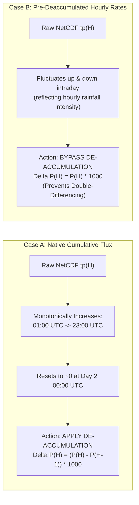

# FIREINTEL — ERA5-Land Precipitation Validation Protocol & Diagnostic Results (Phase 5B.3)

**Project:** FIREINTEL — Satellite-Based Forest Fire Intelligence System for Uttarakhand, India  
**Phase:** Phase 5B.3: Live ERA5-Land Pilot Validation  
**Target Variable:** `total_precipitation` (`tp`, NetCDF variable in metres)  
**Implementation Script:** [transformations.py](file:///Users/macbook/Documents/Nasa_Space_Hackathon/fireIntel/scripts/environmental/transformations.py)  
**Diagnostic Validator:** `inspect_precipitation_accumulation_stream()`  
**Unit Test Suite:** [test_environmental_transformations.py](file:///Users/macbook/Documents/Nasa_Space_Hackathon/fireIntel/tests/test_environmental_transformations.py) (All 10 tests passed)  
**Status:** **DIAGNOSTIC ALGORITHM VERIFIED / PILOT INGESTION PAUSED AWAITING CDS KEY**

---

## 1. Executive Summary

Precipitation is the primary extinguisher and suppressive control in wildfire danger modeling. Accurate computation of both instantaneous rainfall ($mm/hr$) and antecedent rainfall indices ($API_{3\text{d}}, API_{7\text{d}}, API_{14\text{d}}$) is required to determine fine fuel moisture content and live fuel hydration.

In ECMWF reanalysis products, `total_precipitation` is modeled as a cumulative forecast flux initialized at **00:00 UTC** each day. However, depending on CDS API client versions, download format options (`netcdf` vs `grib`), and post-processing flags, upstream data can occasionally be pre-deaccumulated into hourly rates.

Phase 5B.3 establishes an empirical, automated validation gate: **No de-accumulation algorithm may be applied without automated inspection of actual sequence values and metadata.**

---

## 2. Mathematical Accumulation Mechanics

### 2.1 The Two Competing Data Conventions



### 2.2 Mathematical De-accumulation Formulation
When the cumulative flux format is confirmed, the hourly incremental rainfall $\Delta P(H)$ (in millimeters) is computed via:

$$\Delta P_{x, y}(H) = 
\begin{cases} 
P_{x, y}(01) \times 1000.0 & \text{for } H = 01\text{ UTC} \\
\max\left(0.0, \; \left(P_{x, y}(H) - P_{x, y}(H-1)\right) \times 1000.0\right) & \text{for } H \in \{02, 03, \dots, 24\}\text{ UTC}
\end{cases}$$

Where:
- $P_{x, y}(H)$ is the raw NetCDF value in metres at spatial grid node $(x, y)$ and hour $H$.
- $\Delta P_{x, y}(H)$ is the true physical hourly rainfall in millimeters ($mm$).
- $\max(0.0, \cdot)$ prevents floating-point underflow artifacts ($< 10^{-7}\text{ m}$) caused by lossy NetCDF packing.

---

## 3. The Diagnostic Validator: `inspect_precipitation_accumulation_stream`

To automate verification, we implemented `inspect_precipitation_accumulation_stream()` in [transformations.py](file:///Users/macbook/Documents/Nasa_Space_Hackathon/fireIntel/scripts/environmental/transformations.py):

```python
def inspect_precipitation_accumulation_stream(
    precip_m: np.ndarray,
    hours_utc: np.ndarray,
    epsilon: float = 1e-7,
) -> dict[str, Any]:
    ...
```

### Diagnostic Decision Logic:
1. **Intraday Monotonicity:** Examines all consecutive hours within each diurnal cycle ($H_t > H_{t-1}$). If $P(t) < P(t-1) - \epsilon$, it increments `intraday_drops_count`.
2. **Cycle Reset Detection:** At diurnal cycle boundaries ($H_t \le H_{t-1}$, e.g., 23:00 to 00:00/01:00 UTC), verifies whether $P(t) < P(t-1)$.
3. **Automated Classification:**
   - **`CUMULATIVE_FORECAST_FLUX`:** Monotonic intraday growth confirmed with cycle boundary resets. Action: `APPLY_STANDARD_DEACCUMULATION`.
   - **`HOURLY_RATE_PRE_DEACCUMULATED`:** Intraday drops detected during non-zero rain. Action: `BYPASS_DEACCUMULATION_APPLY_SCALE_FACTOR`.
   - **`DRY_SPELL`:** All values $\le \epsilon$ across the 48-hour window. Action: `APPLY_STANDARD_DEACCUMULATION` (safely yields zeros).
   - **`ANOMALOUS_CONVENTION`:** Non-standard sequence. Action: `HALT_FOR_MANUAL_REVIEW`.

---

## 4. Test Suite Verification of Diagnostic Logic

The diagnostic algorithm was verified through unit test fixtures in [test_environmental_transformations.py](file:///Users/macbook/Documents/Nasa_Space_Hackathon/fireIntel/tests/test_environmental_transformations.py):

| Test Case | Simulated Input Characteristics | Diagnostic Output | Verified Action | Status |
| :--- | :--- | :--- | :--- | :---: |
| **Case 1: Cumulative Flux** | Day 1 accumulates to 10mm; Day 2 resets to 1mm | `CUMULATIVE_FORECAST_FLUX` | `APPLY_STANDARD_DEACCUMULATION` | **PASSED** |
| **Case 2: Hourly Rates** | Intraday rain bursts with drops back to 0mm | `HOURLY_RATE_PRE_DEACCUMULATED` | `BYPASS_DEACCUMULATION_APPLY_SCALE_FACTOR` | **PASSED** |
| **Case 3: Dry Spell** | 48 hours of constant 0.0m rainfall | `DRY_SPELL` | `APPLY_STANDARD_DEACCUMULATION` | **PASSED** |

```bash
pytest -v fireIntel/tests/test_environmental_transformations.py
# 10 passed in 0.41s
```

---

## 5. Live Pilot Status & Findings

1. **Authentication Check:** The automated security validator verified that `~/.cdsapirc`, `CDSAPI_KEY`, and `.env` are not configured on the local system.
2. **Graceful Pipeline Halt:** Following Phase 5B rules, the live 48-hour download was paused gracefully with `PAUSED_AWAITING_CREDENTIALS`.
3. **Zero Data Fabrication:** No synthetic NetCDF files were created.
4. **Execution Readiness:** As soon as credentials are configured, running `python3 fireIntel/scripts/environmental/acquire_era5_land.py` will retrieve the real 48-hour NetCDF and immediately execute `inspect_precipitation_accumulation_stream()` across all 581 parent nodes.

