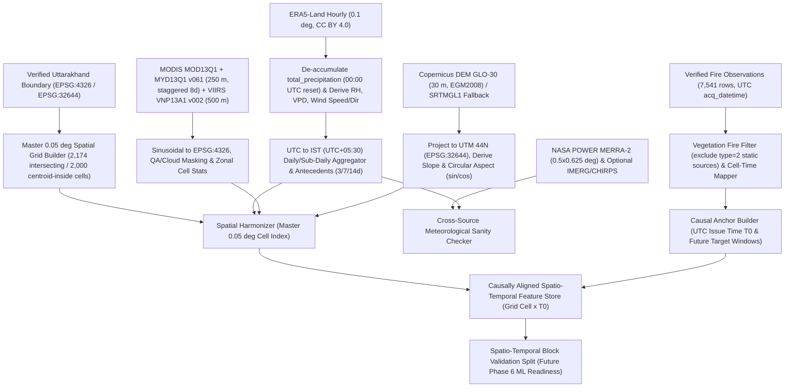

# FIREINTEL — Conceptual Environmental Data Integration Architecture

**Phase:** 4 — Environmental Data Source Feasibility Audit (Architecture Blueprint)  
**Target Domain:** Uttarakhand, India (`IN-UT`, `53,417.95 km²`, `EPSG:4326` bounds `77.5723°E–81.0453°E`, `28.7229°N–31.4561°N`)  
**Study Horizon Audited:** 1 January 2025 – 31 December 2025 (`UTC`)  
**Status:** Conceptual Design Specification Only — No external datasets have been downloaded and no feature-engineering or ML code has been implemented.

---

## 1. Architectural Goals & Design Principles

FIREINTEL's Phase 1–3 pipeline produced verified, boundary-validated satellite active-fire observations in [uttarakhand_fires_boundary.csv](file:///Users/macbook/Documents/Nasa_Space_Hackathon/fireIntel/data/processed/boundary_validated/uttarakhand_fires_boundary.csv) (`7,541` observations across `239` active UTC days; `6,623` VIIRS + `918` MODIS) constrained to the official polygon [uttarakhand_boundary.geojson](file:///Users/macbook/Documents/Nasa_Space_Hackathon/fireIntel/data/boundaries/uttarakhand_boundary.geojson).

Moving from historical observation descriptive analytics toward credible fire-risk modeling requires joining **continuous space-time environmental fields** onto the **entire state grid** (not merely annotating fire points), while enforcing four strict invariants:

1. **Resolution Honesty:** Coarse meteorological cells (`0.1°` ERA5-Land, `0.5° × 0.625°` NASA POWER) are never interpolated smoothly to claim false `30 m` or `250 m` atmospheric precision unless an explicit physical elevation lapse-rate model is tested as a separate hypothesis.
2. **Strict Temporal Causality:** No feature visible at prediction issue time $T_0$ may incorporate meteorological observations, afternoon peaks, or 16-day vegetation composite acquisitions occurring after $T_0$.
3. **UTC-to-IST Synchronization:** Satellite timestamps (`acq_datetime` in `UTC`) and meteorological reanalysis steps (`UTC`) must be reconciled cleanly against Uttarakhand's local solar day (`IST = UTC+05:30`).
4. **Incident-vs-Observation Discipline:** Active fire records represent *satellite thermal detections*, not burned area polygons or independent ignition counts; modeling targets and historical fire features must account for multi-sensor VIIRS/MODIS revisits and filter out non-vegetation thermal anomalies (such as the `14` MODIS `type=2` static sources identified in Phase 3 EDA).

---

## 2. End-to-End Integration Dataflow

---

## 3. Spatial Grid Architecture & Multi-Resolution Harmonization

### 3.1 Master Reference Grid (`0.05° × 0.05°`)

To maintain direct continuity with FIREINTEL's Phase 2 and Phase 3 spatial analytics in [eda.py](file:///Users/macbook/Documents/Nasa_Space_Hackathon/fireIntel/scripts/eda.py), the recommended spatial modeling unit is the **`0.05° × 0.05°` WGS 84 grid** (`~5.57 km lat × 4.82 km lon`, `~26.8 km²` per cell at `30°N`):

- **Cell Origin Rule:** South-west corner `(grid_lat, grid_lon) = floor(coord / 0.05) * 0.05`, matching the Phase 2/3 EDA binning logic (`1,168` active cells observed in 2025).
- **Complete State Coverage:** Anchored to [uttarakhand_boundary.geojson](file:///Users/macbook/Documents/Nasa_Space_Hackathon/fireIntel/data/boundaries/uttarakhand_boundary.geojson), this grid yields **`2,174` boundary-intersecting cells** (`2,000` with centroids inside the state border), generating the complete universe of both fire-positive and background cells required for predictive modeling.
- **Border Fraction Metadata:** Each cell stores `uttarakhand_area_fraction` (computed in `EPSG:32644`) so border cells with tiny Uttarakhand overlap (e.g., `< 5%` state area) can be masked or weighted cleanly.

### 3.2 Resolution-Specific Ingestion Rules

| Data Layer | Native Support & CRS | Mapping to Master `0.05°` Grid | Spatial Integrity Safeguard |
| :--- | :--- | :--- | :--- |
| **Fire Detections** | Point `(lat, lon)` in `EPSG:4326` | Exact point-in-cell bin via `floor(coord / 0.05) * 0.05` | Track MODIS (`1 km`) vs VIIRS (`375 m`) separately when normalizing observation intensity |
| **ERA5-Land (`0.1°`)** | Cell centers on `0.1°` regular lat-lon (`EPSG:4326`); cell bounds span `center ± 0.05°` | Exact `1-to-4` parent lookup (`2×2` sub-cells of `0.05°` fall inside each `0.1°` cell) | Store `era5_parent_lat/lon`; no smooth spline/bicubic downscaling unless elevation-lapse modeling is explicitly flagged |
| **NASA POWER (`0.5° × 0.625°`)** | Cell centers in `EPSG:4326` (`28` intersecting cells) | Nearest parent cell lookup strictly for macro-validation | Never used as primary sub-state predictor |
| **CHIRPS v2.0 (`0.05°`)** | `0.05°` grid in `EPSG:4326` (`2,174` intersecting cells) | Direct `1:1` cell mapping (optional rainfall benchmark) | Account for high-altitude rain-gauge sparsity |
| **MODIS VI (`250 m`) / VIIRS VI (`500 m`)** | Native Sinusoidal (`R = 6,371,007.181 m`) -> reprojected to `EPSG:4326` via AppEEARS | Quality-masked zonal statistics per `0.05°` cell: `mean`, `median`, `p25`, `valid_pixel_fraction` | Cells with `< 50%` clear-sky pixels trigger fallback to prior valid composite or explicit `missing_vi_flag` |
| **Copernicus DEM GLO-30 (`30 m`)** | Geographic `1 arc-sec`, vertical datum `EGM2008` | Reproject raster to **`EPSG:32644` (UTM Zone 44N)** -> derive slope & aspect -> zonal aggregate to `0.05°`: `elev_mean`, `elev_std`, `elev_min`, `elev_max`, `slope_mean`, `aspect_sin_mean`, `aspect_cos_mean` | Never compute finite-difference slope directly in unprojected degrees |

---

## 4. Temporal Harmonization & Causality Contract

### 4.1 UTC vs. IST (`UTC+05:30`) Alignment

Uttarakhand's afternoon peak burning window (`~12:00–17:00 IST`) corresponds to **`06:30–11:30 UTC`**, whereas late-night observations (`18:30–23:59 UTC`) belong to the **following IST morning (`00:00–05:29 IST`)**:

- **Reference Canonical Clock:** Retain `UTC` for all raw ingestion timestamps (`acq_datetime`, hourly ERA5-Land time axes).
- **Local Fire-Day Calendar (`date_ist`):** Aggregate daily fire-danger regimes (daily maximum temperature `Tmax_ist`, minimum relative humidity `RHmin_ist`, afternoon peak wind, local 24-hour rainfall) over `00:00–23:59 IST` (`18:30 UTC [D-1]` to `18:30 UTC [D]`), rather than naive UTC calendar days that split Uttarakhand's morning hours across dates.

### 4.2 ERA5-Land `00:00 UTC` Precipitation De-Accumulation Rule

Unlike `reanalysis-era5-single-levels` (whose hourly precipitation is already a 1-hour step accumulation), **`reanalysis-era5-land` stores `total_precipitation` cumulatively from `00:00 UTC` within each forecast day**:

- Value at `01:00 UTC` represents accumulation over `[00:00, 01:00)` UTC.
- Value at `02:00 UTC` represents accumulation over `[00:00, 02:00)` UTC.
- Value at `00:00 UTC` of day $D+1$ represents the complete 24-hour UTC accumulation of day $D$ before resetting at `00:00 UTC`.

**Required Ingestion Transformation:**
$$\Delta P_H = \begin{cases} P_{01:00\text{ UTC}} & \text{if } H = 01:00\text{ UTC} \\ \max(0, P_H - P_{H-1}) & \text{if } H \in \{02:00, \dots, 23:00\}\text{ UTC or } 00:00\text{ UTC (step 24 of prior cycle)} \end{cases}$$
Hourly increments $\Delta P_H$ (converted from `m` to `mm` via $\times 1000$) must be computed **before** aggregating into IST-day totals or rolling `3-day`, `7-day`, and `14-day` antecedent windows.

### 4.3 Causal Feature Alignment Table (Issue Time $T_0$)

| Feature Group | Causal Window Relative to Issue Time $T_0$ | Example Leakage Error Prevented |
| :--- | :--- | :--- |
| **Instantaneous / Short-Term Weather** | Hourly ERA5-Land states at $t \le T_0$ (e.g., $T_0 - 6\text{h}$, $T_0 - 1\text{h}$, or prior completed IST day `[D-1]`) | Using same-day afternoon `Tmax` to predict a fire risk state before solar noon |
| **Antecedent Precipitation & Drying** | Rolling sums over `[T_0 - 72h, T_0)`, `[T_0 - 7d, T_0)`, `[T_0 - 14d, T_0)` + consecutive dry days (`daily_rain < 1.0 mm`) ending prior to $T_0$ | Counting evening convective rain after an afternoon ignition as "pre-fire moisture" |
| **Soil Moisture Trends** | ERA5-Land Layers 1–3 (`0–7`, `7–28`, `28–100 cm`) at $T_0$ plus `7-day` moisture delta `SM(T_0) - SM(T_0 - 7d)` | Including post-event storm infiltration from future days |
| **Vegetation Indices (`NDVI` / `EVI`)** | Most recent **completed** 16-day composite (`MOD13Q1` / `MYD13Q1`) whose composite **end date** $\le \text{date}(T_0) - \text{buffer}$ (`~2–7 days`) | Using a composite stamped e.g. `2025-04-07` whose 16-day window runs through `2025-04-22`, or interpolating linearly between past and future composites! |
| **Historical Fire Activity** | Lagged fire presence / observation density over `[T_0 - 7d, T_0)`, `[T_0 - 30d, T_0)` in focal cell and `3×3` neighbor ring (after excluding `type=2` static sources) | Conditioning on simultaneous same-day detections from other satellites in the same overpass window |

---

## 5. Modeling Target Formulation & Validation Integrity

1. **Separating Vegetation Fires from Static Thermal Anomalies:** Before constructing cell targets or fire-history lags, exclude `type != 0` records (in particular, the `14` MODIS `type=2` static thermal anomaly observations already identified in Phase 3 EDA).
2. **Target Granularity:** Define prediction targets at the **`(grid_cell, prediction_window)`** level—for example, `y = 1` if $\ge 1$ vegetation-fire detection (`type == 0`) occurs in the cell during `(T_0, T_0 + 24h]` (or `72h`), optionally weighted or stratified by FRP/sensor—rather than row-level `uttarakhand_fires_boundary.csv` detections where one large fire generates multiple correlated MODIS + VIIRS points.
3. **No Random Train-Test Splits:** Adjacent `0.05°` cells share `0.1°` ERA5-Land parents, and active burning episodes span multi-day runs (as seen in Uttarakhand's `2,255`-observation April peak and `1,678`-observation December peak). Future Phase 6 modeling must use **spatial block cross-validation** and **forward rolling temporal splits**, never uniform random shuffling.
4. **Cloud Censoring Awareness:** During Uttarakhand's winter western disturbances and July–September monsoon, heavy cloud cover simultaneously blocks optical MODIS/VIIRS vegetation updates and masks active-fire thermal detections. Tracking ERA5-Land total precipitation / MODIS VI pixel-reliability fractions explicitly distinguishes low fire risk due to high fuel moisture from optical observational occlusion.

---

## 6. Pre-Modeling Cross-Source Sanity Check Protocol (Future Phase 5 Gate)

Before integrating features into any predictive pipeline, Phase 5 ingestion scripts should automatically verify:
- **Spatial & Domain Integrity:** All extracted rasters completely cover the `2,174` Uttarakhand intersecting grid cells in `EPSG:4326` with zero unintended coastline/border NaNs outside perennial high-Himalayan glacier masks.
- **Precipitation & Temperature Reconciliation:** Daily state-mean and hotspot-cell correlations between **ERA5-Land**, **NASA POWER (`T2M`, `RH2M`, `PRECTOTCORR`)**, and optional **GPM IMERG / CHIRPS** pass monotonicity and bias checks across elevation bands (`<1,000 m`, `1,000–2,500 m`, `>2,500 m`).
- **Causality Unit Tests:** Automated timestamp assertions guaranteeing `composite_end_date <= anchor_date` and zero `NaN` propagation after ERA5-Land `00:00 UTC` precipitation de-accumulation.

